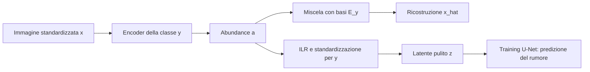
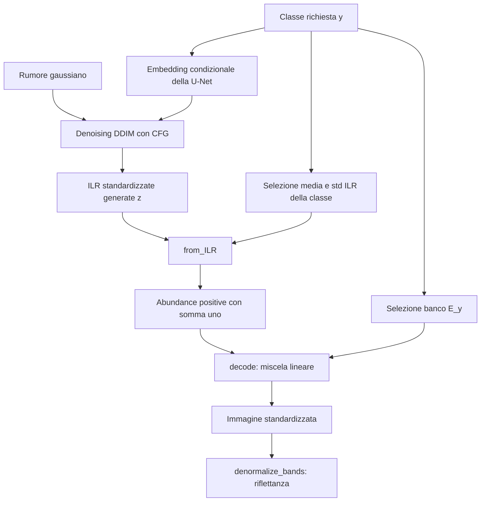

# Latent unmixing per class — guida tecnica

Questa guida descrive l'implementazione in `experiments/latent_unmixing_per_class/`.
Serve a collegare il problema scientifico ai tensori, alle funzioni e alle scelte
che occorre preservare quando si modifica il codice. Non descrive la variante
`latent_unmixing_per_class_large`.

Il riferimento per i valori configurabili è [config.json](config.json); quello
per i requisiti generali è [AGENTS.md](../../AGENTS.md). Le spiegazioni delle
motivazioni e delle alternative sono deduzioni dall'architettura implementata:
non sono risultati di ablation study. Le limitazioni indicate descrivono il
codice attuale, senza introdurre modifiche al modello.

## Indice

1. [Scope: problema, architettura, dati e limiti](#1-scope-problema-architettura-dati-e-limiti)
2. [Blocchi necessari e loro motivazione](#2-blocchi-necessari-e-loro-motivazione)
   - [Processo ILR: significato, trasformazione e inversa](#24-conversione-ilr-e-standardizzazione-per-classe)
3. [Flusso dei dati: concetto e implementazione](#3-flusso-dei-dati-concetto-e-implementazione)
4. [Preview, salvataggio dei risultati e analisi](#4-preview-salvataggio-dei-risultati-e-analisi)
5. [Orientarsi nelle modifiche e nei requisiti](#5-orientarsi-nelle-modifiche-e-nei-requisiti)
6. [Riferimenti teorici](#6-riferimenti-teorici)

Per cercare subito dove viene svolta un'operazione, usa la
[tabella rapida delle funzionalità](#tabella-rapida-funzionalità-e-codice).

## 1. Scope: problema, architettura, dati e limiti

### 1.1 Il problema affrontato

Il progetto deve generare immagini EuroSAT multispettrali coerenti sia nello
spazio sia nelle relazioni tra bande. Una buona visualizzazione RGB, da sola,
non verifica la plausibilità delle altre bande. La firma spettrale media per
classe, chiamata RMC nel repository, è uno dei controlli disponibili.

Questo esperimento introduce una struttura precisa: ogni pixel generato deve
essere una miscela di un piccolo numero di spettri appartenenti alla classe
richiesta. La rete generativa impara la distribuzione spaziale dei pesi di
miscela; gli spettri sono appresi prima e poi congelati.

Si separano quindi due problemi:

1. **Rappresentazione:** quali basi e quali mappe di pesi ricostruiscono le
   immagini reali di ciascuna classe?
2. **Generazione:** come produrre nuove mappe di pesi con una struttura spaziale
   plausibile, per poi convertirle in immagini multispettrali?

La separazione rende esplicito il legame fra generazione e ricostruzione
spettrale. Introduce però un collo di bottiglia: la diffusione può generare
soltanto immagini rappresentabili dalle basi congelate.

### 1.2 L'architettura in una pagina

Indichiamo con `N` il numero di classi, `C` le bande, `K` le basi per classe e
`B` la dimensione del batch. `H` e `W` sono le dimensioni spaziali. La label
`y` identifica la classe dell'intera immagine, non il materiale di ogni pixel.

| Oggetto | Simbolo | Forma nel codice | Significato |
| --- | --- | --- | --- |
| Immagini standardizzate | `x` | `[B,C,H,W]` | Input degli encoder e output del decoder |
| Label reali | `y` | `[B]` | Selezionano encoder, statistiche e basi |
| Banchi spettrali | `E` | `[N,K,C]` | Un banco apprendibile per ogni classe |
| Logits | `l` | `[B,K,H,W]` | Output libero dell'encoder selezionato |
| Abundance | `a` | `[B,K,H,W]` | Pesi positivi, con somma uno sulle `K` basi |
| Coordinate ILR grezze | `u` | `[B,K-1,H,W]` | Rappresentazione libera dei rapporti fra abundance |
| Coordinate ILR standardizzate | `z` | `[B,K-1,H,W]` | Dati puliti del modello a diffusione |
| Rumore e rumore predetto | `noise`, `prediction` | `[B,K-1,H,W]` | Target e output della U-Net |

La configurazione presente al momento della stesura usa `N=10`, `C=13`, `K=6`
e immagini `64×64`: il latente ha quindi cinque canali a risoluzione `64×64`.
Questi numeri sono un esempio per leggere le forme; per modificarli si usa il
config, non la documentazione.



Il ramo di ricostruzione viene addestrato nello **stadio encoder**. Nel
successivo **stadio DDPM**, encoder e basi restano congelati: si addestra solo
la U-Net. Il collegamento tra i rami è il checkpoint `best` dell'unmixing.

In generazione si percorre invece:

```text
rumore gaussiano → denoising condizionale → z generato
                 → inversione della standardizzazione e della ILR
                 → abundance → miscela con E_y → immagine
```

Non è un VAE: non ci sono posteriori gaussiani appresi né loss KL. Inoltre
"latente" indica qui soprattutto una riduzione delle dimensioni **spettrali**.
L'encoder non riduce `H` e `W`. La U-Net usa risoluzioni interne diverse per
modellare il contesto, ma ingresso e uscita conservano la griglia delle abundance.

### 1.3 Unmixing lineare e significato fisico

Per ogni pixel `p`, il decoder della classe `y` calcola:

```text
x_hat[c,p] = Σ_k a[k,p] E[y,k,c]
a[k,p] > 0,   Σ_k a[k,p] = 1
```

È una combinazione convessa delle basi: lo stesso vettore di abundance miscela
simultaneamente tutte le bande. Questo lega le bande fra loro anziché predirle
con uscite indipendenti.

**Il vincolo sulle abundance non equivale a una garanzia fisica completa.**
`latent_bases` è un parametro libero nello spazio standardizzato: dopo
l'inizializzazione non è vincolato a spettri di materiali reali, alla positività
in riflettanza o a un intervallo massimo. La loss corrente è soltanto MSE di
ricostruzione. Non sono presenti supervisione dei materiali, sparsità,
separazione delle basi, regolarità spettrale o una loss fisica esplicita.

Una base negativa nello spazio standardizzato è normale: può rappresentare
una riflettanza inferiore alla media. Il controllo fisico va fatto **dopo la
denormalizzazione**. Anche allora il codice non impone positività alle basi.
Il clamp dei valori negativi durante l'esportazione corregge l'output salvato,
ma non modifica quanto il modello ha imparato.

Per `K` basi, gli spettri ricostruibili di una classe appartengono a un inviluppo
convesso con dimensione affine al massimo `K-1`. Con l'esempio `K=6`, la
dimensione massima è cinque nello spazio delle tredici bande. È il vincolo
strutturale centrale: può favorire coerenza e regolarizzazione, ma impedisce di
rappresentare variazioni spettrali esterne a quell'inviluppo. La diffusione non
può recuperare una componente eliminata dalla rappresentazione.

Le basi non sono inoltre identificabili in modo univoco dalla sola
ricostruzione: scambiare insieme basi e canali delle abundance lascia invariato
il decoder. Fra classi, `E[y,0]` non deve rappresentare lo stesso materiale di
`E[y_altro,0]`. Questo conta anche nello spazio ILR: una coordinata non ha una
semantica materiale universale.

### 1.4 Perché uno spazio ILR

Le abundance vivono nel **simplesso**: le `K` componenti sono positive e sommano
a uno. Hanno dunque `K-1` gradi di libertà. Aggiungere rumore gaussiano
direttamente a queste `K` componenti produce, in generale, valori negativi e
una somma diversa da uno. Si potrebbe costruire un processo con proiezioni o
una diffusione specifica sul simplesso; il codice sceglie invece di trasformare
i dati in coordinate reali prima di usare una diffusione gaussiana ordinaria.

La ILR, *isometric log-ratio*, rappresenta i rapporti fra componenti mediante
`K-1` coordinate reali. La sua isometria riguarda la geometria composizionale
di Aitchison, non la distanza euclidea fra vettori di abundance né la distanza
fra spettri ricostruiti.
[Riferimento originale di Egozcue et al.](https://recerca.udg.edu/en/publications/isometric-logratio-transformations-for-compositional-data-analysi/)

Nel codice la trasformazione è costruita con logaritmi centrati e una base
ortonormale di Helmert. La sezione 2.4 ne mostra tutti i passaggi. La successiva
standardizzazione per coordinata è un'ulteriore trasformazione: con deviazioni
standard diverse, le distanze euclidee nello spazio standardizzato non sono più
le distanze della ILR grezza.

Le criticità operative sono:

- **Zeri e bordi:** `log(0)` non esiste; abundance quasi nulle producono valori
  ILR molto grandi in modulo. `simplex.epsilon` limita l'avvicinamento al bordo.
- **Inversione approssimata:** clamp e arrotondamenti possono modificare le
  componenti molto piccole. Gli zeri esatti non sono rappresentati.
- **Dipendenza dalla rappresentazione:** cambiare encoder, basi, ordine delle
  componenti o base ILR cambia il significato dei latenti del DDPM.
- **Scala:** una coordinata dominante può squilibrare il rapporto
  segnale/rumore rispetto alle altre; da qui le statistiche ILR per classe.
- **Interpretazione:** un errore piccolo nel latente non si traduce in un errore
  spettrale costante. Inversione non lineare e basi determinano l'effetto finale.

### 1.5 Dati utilizzati e confini dell'esperimento

L'input effettivo è **EuroSAT MS**, letto da [dataset.py](../../dataset.py).
Le immagini RGB di EuroSAT non sono un secondo input di questo esperimento:
l'RGB usato nelle preview deriva dalle bande multispettrali.

`EuroSATMSDataset` ordina le directory delle classi e poi i file TIFF, legge i
valori in `float32` e converte `[H,W,C]` in `[C,H,W]`. Il dataset non effettua
automaticamente divisione per la scala, resize o riordinamento delle bande.
La trasformazione viene assegnata successivamente con
`apply_band_normalization`.

L'ordine delle bande è quello dei TIFF e di `data.band_names`. Nel config,
`B8A` è in ultima posizione, anche se la sua lunghezza d'onda è intermedia:
l'ordinamento per lunghezza d'onda viene fatto solo per disegnare i grafici.
Riordinare soltanto i nomi nel config non riordina i tensori.

Lo split è stratificato e riproducibile, con quote 90% training, 5% validation
e 5% test. Le statistiche e l'inizializzazione delle basi usano il training;
la validation seleziona i due checkpoint `best`; il test entra nell'evaluation
finale. Nella pipeline di training non sono implementate augmentation.

## 2. Blocchi necessari e loro motivazione

### 2.1 Mappa dei file e delle responsabilità

I simboli riportati permettono di raggiungere il blocco con la ricerca del
proprio editor. I percorsi sono cliccabili; non si usano numeri di riga che
diventerebbero obsoleti modificando il codice.

| File | Simboli principali | Responsabilità |
| --- | --- | --- |
| [dataset.py](../../dataset.py) | `EuroSATMSDataset` | Lettura TIFF, mapping classi, forme dei dati |
| [config.json](config.json) | Sezioni `data`, `model`, `simplex`, `ddpm_model`, `diffusion`, `cfg`, training e percorsi | Scelte configurabili delle due fasi |
| [train.py](train.py) | `main` | Avvio di uno o entrambi gli stadi |
| [model.py](model.py) | `ResidualBlock`, `AbundanceEncoder`, `ClassSpecificLatentUnmixingModel` | Encoder per classe e decoder lineare |
| [model.py](model.py) | `create_ddpm_model`, `create_training_scheduler`, `create_sampling_scheduler`, `generate_ILR` | U-Net, processi di rumore e denoising |
| [utils.py](utils.py) | Split, sampler, statistiche, ILR, normalizzazioni, checkpoint e RNG | Preparazione e trasformazioni dell'esperimento |
| [train_encoder.py](train_encoder.py) | `main`, `validate` | Ottimizzazione della rappresentazione e selezione `best` |
| [train_ddpm.py](train_ddpm.py) | `main`, `validate` | Ottimizzazione del denoiser, EMA e selezione `best` |
| [sample.py](sample.py) | `main` | Caricamento del generatore e sampling di una classe |
| [evaluation.py](evaluation.py) | `generate_samples`, `spectra`, `draw`, `save_plots`, `main` | Generazione condivisa con il sampling e confronto RMC |
| [eval/eval_ann.py](eval/eval_ann.py) | `read_region_spectrum`, `collect_spectra`, `plot_rmc` | Analisi di regioni annotate |

Nello stato esaminato non esiste `experiments/common/`: questi entry point
contengono loop propri e importano le utility dell'esperimento. La struttura
condivisa descritta in `AGENTS.md` è un requisito generale, non un componente
da cercare in questa pipeline attuale.

#### Tabella rapida: funzionalità e codice

La prima colonna indica cosa vuoi trovare; la seconda dove cercarlo; la terza
riassume le parti del blocco che contano per capirlo o modificarlo. Quando non
esiste una funzione dedicata, è indicato il pezzo del `main` che svolge il lavoro.

| Funzionalità | Funzioni o blocchi da cercare | Parti importanti, in breve |
| --- | --- | --- |
| Scegliere lo stadio da eseguire | [train.py](train.py): `main` | `--stage` sceglie encoder, DDPM o entrambi. Ogni stadio decide separatamente se riprendere una run. |
| Leggere la configurazione | [utils.py](utils.py): `load_config` | Legge `config.json` e completa i percorsi partendo dalla root del progetto. |
| Leggere TIFF e label | [dataset.py](../../dataset.py): `EuroSATMSDataset.__getitem__` | Legge il TIFF in `float32`, sposta le bande nel primo asse e applica la trasformazione assegnata. Restituisce immagine e classe. |
| Dividere training, validation e test | [utils.py](utils.py): `split_indices` | Mescola gli indici di ciascuna classe con un seed fisso. Le tre liste vengono poi conservate nei checkpoint. |
| Creare batch bilanciati | [utils.py](utils.py): `BalancedBatchSampler.__iter__`, `set_epoch` | Prende lo stesso numero di immagini per classe. Ripete quelle necessarie e cambia l'ordine a ogni epoca in modo riproducibile. |
| Calcolare le statistiche delle bande | [utils.py](utils.py): `compute_band_stats`, `load_or_compute_band_stats` | Calcola media e std sui pixel del training, dopo la divisione per la scala di riflettanza. La seconda funzione gestisce il file di statistiche già salvato. |
| Normalizzare le immagini | [utils.py](utils.py): `apply_band_normalization` | Imposta `dataset.transform`: divide per la scala, sottrae la media di banda e divide per la std. Non cambia l'ordine delle bande. |
| Inizializzare le basi di ogni classe | [utils.py](utils.py): `sample_class_training_pixels` | Sceglie un pixel da ciascuna di `K` immagini di training della classe. Usa spettri già normalizzati e registra da dove provengono. |
| Estrarre informazioni dai pixel vicini | [model.py](model.py): `AbundanceEncoder.forward`, `ResidualBlock.forward` | Le convoluzioni usano il vicinato senza ridurre la risoluzione. Ogni blocco somma una correzione all'ingresso; GroupNorm regola le scale interne. |
| Usare l'encoder della classe corretta | [model.py](model.py): `ClassSpecificLatentUnmixingModel.encode` | Raccoglie gli esempi con la stessa label, chiama il loro encoder e usa `index_copy` per rimetterli nelle posizioni originali del batch. |
| Ottenere abundance positive a somma uno | [model.py](model.py): softmax in `AbundanceEncoder.forward` | Divide i logits per la temperatura e applica softmax sulle `K` basi, in `float32`. Ogni pixel ottiene un peso per base. |
| Ricostruire tutte le bande | [model.py](model.py): `ClassSpecificLatentUnmixingModel.decode` | Seleziona il banco della classe e usa `einsum` per sommare le basi pesate dalle abundance. Gli stessi pesi valgono per tutte le bande. |
| Addestrare encoder e basi | [train_encoder.py](train_encoder.py): ciclo dei batch in `main` | Confronta ricostruzione e immagine con MSE. Il backward aggiorna insieme encoder e basi; i due gruppi possono avere learning rate diversi. |
| Valutare la ricostruzione | [train_encoder.py](train_encoder.py): `validate` | Usa la validation senza gradienti. Restituisce la MSE media, che decide quale encoder salvare come `best`. |
| Passare dalle abundance alla ILR grezza | [utils.py](utils.py): `_raw_ILR`, `helmert_basis` | Evita `log(0)` con una soglia, centra i logaritmi e li converte in `K-1` valori tramite la matrice di Helmert. Non riduce altezza e larghezza. |
| Stimare le statistiche ILR per classe | [utils.py](utils.py): `compute_ILR_statistics` | Usa l'encoder congelato sui soli dati di training. Calcola media e std per classe e coordinata; limita inferiormente la std per evitare divisioni per zero. |
| Preparare il dato pulito del DDPM | [utils.py](utils.py): `to_ILR`, `_class_statistics` | Calcola la ILR grezza, seleziona media e std usando le label reali e restituisce `(ILR - media) / std`. |
| Recuperare le abundance dai latenti generati | [utils.py](utils.py): `from_ILR` | Annulla la standardizzazione, ricostruisce i logaritmi centrati e applica softmax. Alla fine protegge i pesi molto piccoli e li riporta a somma uno. |
| Mantenere fissa la rappresentazione durante il DDPM | [train_ddpm.py](train_ddpm.py): costruzione di `unmixing` e blocco `torch.no_grad()` in `main` | Carica l'unmixing selezionato, lo mette in `eval` e disabilita i suoi gradienti. Nei batch produce abundance e latenti senza aggiornare encoder o basi. |
| Costruire la rete che predice il rumore | [model.py](model.py): `create_ddpm_model` | Crea una sola U-Net con `K-1` canali in ingresso e uscita. Prevede embedding per le classi reali e una classe aggiuntiva senza condizione. |
| Aggiungere rumore ai latenti | [model.py](model.py): `create_training_scheduler`; [train_ddpm.py](train_ddpm.py): `noise`, `timesteps`, `add_noise` | Estrae rumore e un timestep per immagine. Lo scheduler combina dato pulito e rumore con l'intensità prevista per quel timestep. |
| Addestrare anche senza condizione di classe | [train_ddpm.py](train_ddpm.py): `model_labels` e `dropped` in `main` | Copia le label e ne sostituisce una parte con la classe nulla, solo per la U-Net. Encoder e statistiche continuano a usare le label reali. |
| Addestrare il DDPM | [train_ddpm.py](train_ddpm.py): predizione, MSE e accumulo in `main` | La rete predice il rumore aggiunto. La MSE viene divisa per il numero di batch del gruppo di accumulo; l'optimizer aggiorna soltanto la U-Net. |
| Limitare i gradienti e usare fp16 | [train_encoder.py](train_encoder.py), [train_ddpm.py](train_ddpm.py): `autocast`, `GradScaler`, `clip_grad_norm_` | Autocast riduce la precisione di alcune operazioni. Lo scaler gestisce il backward; il clipping limita la norma dopo aver annullato la scala dei gradienti. |
| Usare i pesi EMA per scegliere il best DDPM | [train_ddpm.py](train_ddpm.py): `ema.step`, `ema.copy_to`, `validate`, `ema.restore` | Aggiorna una copia smussata dei pesi. La usa per validation e best, poi rimette i pesi di training prima di salvare `latest`. |
| Generare nuovi latenti | [model.py](model.py): `create_sampling_scheduler`, `generate_ILR` | Parte dal rumore. A ogni passo combina la predizione con classe e quella senza classe, poi DDIM aggiorna il latente. Il risultato è ancora ILR standardizzata. |
| Avviare il sampling e scegliere la classe | [sample.py](sample.py): `main`; [evaluation.py](evaluation.py): `generate_samples` | Carica il best DDPM e l'unmixing associato. Genera i batch della classe richiesta e passa da ILR ad abundance, poi al decoder. |
| Tornare alla riflettanza | [utils.py](utils.py): `denormalize_bands` | Calcola `immagine * std + media`. Non rimoltiplica per la scala intera del dataset: l'uscita è già riflettanza. |
| Salvare TIFF MS e RGB corrispondente | [utils.py](utils.py): `save_generated_pair` | Porta a zero le riflettanze negative e salva il TIFF `float32`. Per il PNG seleziona B4/B3/B2 e applica la sola scala di visualizzazione. |
| Controllare le ricostruzioni a fine epoca | [train_encoder.py](train_encoder.py): `save_bases`, `save_rmc` | Disegna le basi in riflettanza e confronta le firme medie reali e ricostruite della validation. Questi controlli non decidono il best. |
| Controllare la generazione a fine epoca | [train_ddpm.py](train_ddpm.py): `save_preview` | Usa un seed fisso per generare un esempio per classe con EMA. Converte i risultati in RGB e salva la tavola di preview. |
| Confrontare RMC reali e generate | [evaluation.py](evaluation.py): `main`, `spectra`, `draw`, `save_plots` | Legge i reali dal test e i TIFF sintetici. Calcola una firma media per immagine, poi confronta le medie per classe con MAE/RMSE e disegna le curve. |
| Analizzare solo una regione annotata | [eval/eval_ann.py](eval/eval_ann.py): `read_region_spectrum`, `collect_spectra`, `plot_rmc` | Legge la classe dalla maschera PNG, seleziona i pixel corrispondenti e calcola una firma per immagine. Le regioni grandi non pesano più delle piccole. |
| Salvare best e stato per la ripresa | [train_encoder.py](train_encoder.py), [train_ddpm.py](train_ddpm.py): `is_best` e blocchi `torch.save` | Il best cambia solo se migliora la validation. Il latest viene scritto a ogni epoca con optimizer, scaler, split e stato casuale; nel DDPM include anche EMA. |
| Riprendere una run | [utils.py](utils.py): `latest_checkpoint`, `get_random_state`, `set_random_state`; blocchi `load_state_dict` nei training | Trova il latest più recente, ripristina modello e stato del training e riparte dall'epoca successiva. Ogni stadio usa il proprio flag `resume`. |
| Registrare l'andamento del training | [utils.py](utils.py): `append_log`; chiamate nei due training | Aggiunge subito una riga JSONL. Registra avvio/ripresa e riepiloghi di epoca; in questa variante non salva ancora un record per ogni batch. |

### 2.2 Dataset, split, bilanciamento e inizializzazione

In [utils.py](utils.py):

| Funzione/blocco | Cosa fa | Perché serve e cosa cambia senza |
| --- | --- | --- |
| `split_indices` | Mescola separatamente gli indici di ogni classe con un generatore fissato dal seed | Mantiene le classi nei tre split e rende riutilizzabile la divisione. Uno split non stratificato può alterare il peso delle classi nei confronti |
| `BalancedBatchSampler` | Emette lo stesso numero di esempi per classe in ogni batch | Ogni encoder riceve esempi a ogni aggiornamento e la U-Net vede classi con peso uniforme. Senza bilanciamento, le classi numerose dominerebbero la frequenza degli aggiornamenti |
| `sample_class_training_pixels` | Sceglie `K` immagini distinte per classe e un pixel casuale da ciascuna | Inizializza le basi con spettri osservati della stessa classe; inizializzare liberamente a caso sarebbe possibile, ma partirebbe da miscele senza questo riferimento ai dati |
| `basis_sources` | Registra indice dell'immagine, riga e colonna dei pixel scelti | Traccia l'inizializzazione; non indica dove siano arrivate le basi dopo l'ottimizzazione |

Il sampler richiede che `batch_size` sia multiplo del numero di classi. Ripete
le classi meno numerose, e se necessario alcuni campioni della più numerosa,
per completare batch bilanciati. Un'epoca non equivale quindi a una visita
esatta e unica di ogni immagine. `set_epoch(epoch)` usa `seed + epoch` per
cambiare l'ordine mantenendolo riproducibile anche dopo il resume.

Lo split usa `int(n * quota)` per training e validation; il test riceve il resto.
La frazione test nel config descrive la ripartizione desiderata, ma non viene
usata direttamente come dimensione nel codice. Validation e statistiche usano
`Subset` senza il sampler bilanciato: le statistiche rappresentano i pixel
effettivi del training set, non la distribuzione sovracampionata dei batch.

### 2.3 Normalizzazione delle bande: unità e funzione obiettivo

Qui vanno distinti due passaggi. Per un valore TIFF `d_c`:

```text
r_c = d_c / S                  conversione alla scala di riflettanza
x_c = (r_c - μ_c) / σ_c        standardizzazione della banda
```

`S` è `data.normalization_max`. `μ_c` e `σ_c` sono stimate sui pixel del solo
training set e sono **comuni a tutte le classi**. `compute_band_stats` accumula
somme e quadrati in `float64`; `apply_band_normalization` assegna al dataset
la trasformazione. Le statistiche hanno un valore per banda, non per immagine
o per posizione spaziale.

La divisione per `S` stabilisce le unità fisiche usate dal progetto. La
standardizzazione centra e rende comparabili le scale dei canali per il
training. Quest'ultima modifica anche il significato della MSE:

```text
MSE_standardizzata = media_c,p [(r_hat[c,p] - r[c,p])² / σ_c²]
```

Si sta quindi minimizzando un errore in riflettanza pesato con l'inverso della
varianza della banda. Senza questa standardizzazione, le bande con maggiore
variabilità potrebbero dominare la loss. Standardizzare non garantisce però
un'importanza fisica ottimale: una banda poco variabile viene relativamente
enfatizzata. È una scelta dell'obiettivo, oltre che numerica.

La divisione per `S` e la standardizzazione sono concettualmente distinte,
anche se una standardizzazione coerente dei valori grezzi produrrebbe gli
stessi `x`. Conservare esplicitamente la riflettanza permette di interpretare
statistiche, ricostruzioni e risultati nelle unità corrette.

Perché statistiche globali anziché per classe? Le classi condividono lo stesso
sistema di coordinate delle bande, rendendo direttamente confrontabili basi
e ricostruzioni. Una standardizzazione per classe sarebbe possibile, ma
richiederebbe anche una denormalizzazione delle bande dipendente dalla label
e cambierebbe il peso relativo degli errori.

**Inversa:** `denormalize_bands(x, band_stats)` calcola `x * σ + μ` e restituisce
riflettanza. Non moltiplica nuovamente per `S`. Omettere l'inversa significherebbe
interpretare valori standardizzati, anche negativi, come misure fisiche.

La miscela lineare resta coerente attraverso la trasformazione affine perché
le abundance sommano a uno:

```text
r_hat = σ ⊙ (Σ_k a_k E_k) + μ
      = Σ_k a_k (σ ⊙ E_k + μ)
```

Quindi le basi denormalizzate possono essere interpretate come i vertici della
stessa miscela in riflettanza. Senza il vincolo di somma unitaria, il termine
di media non si distribuirebbe in questo modo.

Due dettagli da conoscere prima di cambiare dataset o split:

- `load_or_compute_band_stats` salva `band_stats.json` nella directory dei
  checkpoint encoder. Il riuso controlla **solo la root del dataset**, benché
  il file registri anche seed, split e scala. Cambiare questi valori o il
  contenuto dei dati mantenendo la root può riusare statistiche obsolete.
- A differenza delle statistiche ILR, la deviazione standard delle bande non
  ha un limite inferiore esplicito nel codice: si assume che non vi siano bande
  costanti. Una banda costante renderebbe non valida la divisione.

### 2.4 Conversione ILR e standardizzazione per classe

Tutto il blocco si trova in [utils.py](utils.py). È utile leggerlo come due
operazioni separate: **cambiare coordinate** e **cambiare scala**.

#### Cosa fa la ILR e su quali dati agisce

La ILR (*isometric log-ratio*) trasforma, **pixel per pixel**, i pesi di miscela
prodotti dall'encoder in coordinate reali utilizzabili dal DDPM. Agisce sulle
abundance, non direttamente sulle tredici bande o sulle basi spettrali.
Non ha parametri appresi: una volta fissati `K` e l'ordine delle componenti,
la matrice della trasformazione è deterministica e comune a tutte le classi.
La parte specifica della classe è la successiva standardizzazione.

Per un pixel, il dominio matematico della ILR è l'interno del simplesso:

```text
S^(K-1) = {a ∈ R^K : a_k > 0 per ogni k, Σ_k a_k = 1}
ILR: S^(K-1) → R^(K-1)
```

Con tre basi, per esempio, `a = (0.5, 0.3, 0.2)` significa che il decoder
miscela il 50%, il 30% e il 20% delle tre basi della classe. La terza quota
è già determinata dalle prime due: `a_3 = 1 - a_1 - a_2`. Ecco perché bastano
due coordinate, anche se le abundance hanno tre canali.

La trasformazione conserva l'informazione sui **rapporti relativi** fra pesi:
il rapporto `a_1/a_2` descrive quanto prevale la prima base sulla seconda.
Il logaritmo converte i rapporti in differenze, perché
`log(a_i/a_j) = log(a_i) - log(a_j)`. Invertire un rapporto ne cambia il
segno; rapporti uguali a uno danno zero. Si ottengono così valori sia positivi
sia negativi, senza imporre al DDPM vincoli di positività o somma unitaria.

Nel caso ideale, senza clamp e arrotondamenti, il passaggio da `K` a `K-1`
canali **non perde informazione**: elimina solo una coordinata ridondante.
Non è una PCA, non seleziona le componenti più importanti e non riduce la
risoluzione spaziale. L'eventuale perdita di informazione spettrale avviene
prima, nella rappresentazione dell'immagine tramite `K` basi.

Il flusso completo è:

```text
a [B,K,H,W]        abundance prodotte dall'encoder
  ↓ soglia epsilon e logaritmo naturale
log(a)            logaritmi dei pesi protetti dalla soglia
  ↓ sottrazione della media sui K canali, per ciascun pixel
clr [B,K,H,W]     K valori con somma zero
  ↓ proiezione sulla base ortonormale di Helmert
u [B,K-1,H,W]     coordinate ILR grezze
  ↓ sottrazione della media e divisione per la std della classe
z [B,K-1,H,W]     coordinate standardizzate usate dal DDPM
```

Le prime operazioni usano soltanto i pesi del singolo pixel. La
standardizzazione usa invece statistiche fisse stimate su tutti i pixel di
training della classe, non statistiche ricalcolate per immagine o per batch.

#### Passo A — Dalle abundance ai logaritmi centrati

`_raw_ILR` converte in `float32` e applica:

```python
positive_abundances = abundances.float().clamp_min(epsilon)
logarithms = positive_abundances.log()
clr = logarithms - logarithms.mean(dim=1, keepdim=True)
```

Il clamp evita `log(0)`. Il centraggio elimina la componente comune ai logaritmi:
somma dei canali CLR uguale a zero, salvo arrotondamenti. Sono ancora `K`
numeri, ma soltanto `K-1` sono indipendenti.

Non serve rinormalizzare dopo il primo clamp: moltiplicare tutte le componenti
per la stessa costante aggiunge lo stesso valore ai logaritmi, che scompare
con il centraggio. Il clamp, invece, modifica davvero i rapporti che coinvolgono
componenti sotto soglia.

Per esplicitare il significato del centraggio, poniamo
`ã_k = max(a_k, epsilon)` e definiamo la media geometrica dei pesi protetti:

```text
g(ã) = (∏_k ã_k)^(1/K)
clr_k = log(ã_k) - (1/K) Σ_j log(ã_j) = log(ã_k / g(ã))
Σ_k clr_k = 0
```

Ogni canale CLR misura quindi il peso di una componente rispetto alla media
geometrica di tutte le componenti. Un valore positivo indica un peso superiore
a questa media; un valore negativo indica un peso inferiore. Per abundance
uniformi `a_k = 1/K`, tutti i valori CLR sono zero.

#### Passo B — Dai K logaritmi centrati a K-1 coordinate

`helmert_basis(K, dtype=..., device=...)` costruisce una matrice `V` di forma
`[K,K-1]`, con colonne ortonormali e a somma zero:

```text
Vᵀ V = I,   Vᵀ 1 = 0
u = Vᵀ clr                  per ogni pixel
```

Con indici matematici a partire da uno, la colonna `q`, per `q=1,…,K-1`, è:

```text
V[k,q] =  1 / √(q(q+1))       se 1 ≤ k ≤ q
V[k,q] = -q / √(q(q+1))       se k = q+1
V[k,q] =  0                  se k > q+1
```

Le colonne sono direzioni perpendicolari di lunghezza unitaria nel piano dei
logaritmi centrati. Poiché quel piano ha dimensione `K-1`, queste colonne lo
descrivono interamente: la proiezione rimuove la ridondanza senza scartare
direzioni ammissibili. **Ortonormali non significa statisticamente
indipendenti**: i valori delle coordinate possono essere correlati nei dati.

L'implementazione applica la stessa matrice a tutti i pixel:

```python
raw_latents = torch.einsum("bkhw,kq->bqhw", clr, basis)
```

`k` è il canale delle abundance e `q` è il canale ILR; batch, altezza e
larghezza restano invariati. La formula generale di ciascuna coordinata è:

```text
u_q = [Σ_(k=1)^q log(ã_k) - q log(ã_(q+1))] / √(q(q+1))
    = √(q/(q+1)) log(g(ã_1,…,ã_q) / ã_(q+1))
```

Qui `g(ã_1,…,ã_q)` è la media geometrica delle prime `q` componenti.
Ogni coordinata è un **bilanciamento**: confronta il gruppo delle prime
`q` basi con la base successiva. Un valore positivo favorisce il gruppo;
zero indica uguaglianza fra la sua media geometrica e il peso della base
successiva; un valore negativo favorisce quest'ultima.

Per `K=3`, la costruzione corrisponde alle coordinate:

```text
V = [ 1/√2    1/√6 ]
    [-1/√2    1/√6 ]
    [  0     -2/√6 ]

u_1 = log(a_1 / a_2) / √2
u_2 = [log(a_1) + log(a_2) - 2 log(a_3)] / √6
```

In queste due formule si assume che nessun peso sia sotto `epsilon`;
altrimenti si sostituiscono le `a_k` con le `ã_k`.
La prima confronta due componenti; la seconda confronta la loro media
geometrica con la terza. Le coordinate possono essere negative senza alcun
problema: rappresentano rapporti, non percentuali.

Con le sei basi dell'esempio di configurazione si ottengono cinque confronti:
`a_1` contro `a_2`, `g(a_1,a_2)` contro `a_3`, fino a
`g(a_1,…,a_5)` contro `a_6`, ciascuno con il proprio fattore di normalizzazione.
Le colonne di `V` non sono le basi spettrali `E`: `V` cambia coordinate fra
pesi, mentre `E` converte i pesi in uno spettro multispettrale.

Perché non usare altre rappresentazioni?

| Alternativa | Differenza rispetto alla scelta attuale |
| --- | --- |
| Abundance dirette | Richiedono di gestire positività e somma durante un processo gaussiano; clamp e rinormalizzazioni cambierebbero il processo |
| Logits dell'encoder | La softmax non cambia aggiungendo una costante comune ai `K` logits: ci sarebbe una direzione ridondante non identificata dalla ricostruzione |
| CLR | Rimuove quella direzione, ma conserva `K` canali soggetti al vincolo di somma zero; il rumore gaussiano indipendente ordinario non resta in quel sottospazio |
| ALR, rapporti a una componente di riferimento | Usa `K-1` canali, ma privilegia un denominatore e non fornisce in generale coordinate ortonormali della geometria composizionale |
| ILR con un'altra base ortonormale | È possibile, ma cambia le coordinate viste dalla U-Net e richiede coerenza in training, statistiche e inversa |

#### In quale senso la trasformazione è isometrica

La proprietà teorica riguarda la distanza di Aitchison fra composizioni
strettamente positive. Con la convenzione di distanza qui usata:

```text
d_A(a,b)² = (1/(2K)) Σ_i Σ_j [log(a_i/a_j) - log(b_i/b_j)]²
         = ||clr(a) - clr(b)||₂²
         = ||ILR(a) - ILR(b)||₂²
```

La base ortonormale permette quindi di misurare questa distanza con la
normale distanza euclidea nelle coordinate grezze.
[Egozcue et al., 2003](https://doi.org/10.1023/A:1023818214614)

Per l'implementazione seguono due precisazioni. Se interviene il clamp, si
rappresentano le composizioni modificate dalla soglia. Inoltre, dividere ogni
coordinata per una std diversa cambia il peso delle direzioni: la distanza fra
`z` standardizzate non coincide più, in generale, con `d_A`.

#### Passo C — Statistiche e trasformazione usata dal DDPM

`compute_ILR_statistics` percorre il training con l'unmixing già congelato.
Per ogni classe `y` e coordinata `q`, aggrega **tutti i pixel**, accumulando
somme e quadrati in `float64`. Calcola media e deviazione standard di
popolazione, con un limite inferiore `simplex.statistics_epsilon` sulla std.

`ilr_stats` contiene `mean` e `standard_deviation` di forma `[N,K-1]`, oltre a
`epsilon`, `num_components`, `latent_channels`, `num_classes` e il nome della
trasformazione. `_class_statistics` seleziona le righe indicate dalle label e
le porta alla forma `[B,K-1,1,1]`, per applicarle a tutti i pixel.

Indicando con `P_y` l'insieme di tutti i pixel di training della classe `y`,
le statistiche corrispondono a:

```text
m[y,q] = (1/|P_y|) Σ_(p∈P_y) u[q,p]
v[y,q] = max((1/|P_y|) Σ_(p∈P_y) u[q,p]² - m[y,q]², 0)
s[y,q] = max(√v[y,q], statistics_epsilon)
```

`to_ILR` restituisce dunque **ILR standardizzate**, non quelle grezze:

```text
z[b,q,p] = (u[b,q,p] - m[y_b,q]) / s[y_b,q]
```

Le statistiche sono per classe perché encoder e basi sono indipendenti: le
distribuzioni dei rapporti possono avere scale e centri molto diversi. La
standardizzazione rende più confrontabile la scala dei segnali su cui agisce
un unico processo di rumore. Con statistiche globali la pipeline sarebbe ancora
definibile, ma alcune classi potrebbero avere segnali molto più grandi di altre
rispetto alla stessa schedule.

Questo passaggio **non allinea i materiali fra classi, non elimina le
correlazioni fra coordinate e non rende i latenti gaussiani**. Porta le medie
e le varianze marginali del training a scale comparabili, salvo le coordinate
con std limitata inferiormente. Il DDPM deve ancora apprenderne la distribuzione.

Senza la soglia sulla std, una coordinata costante provocherebbe una divisione
per zero; una quasi costante potrebbe amplificare eccessivamente piccole
variazioni. `simplex.epsilon` e `simplex.statistics_epsilon` hanno quindi ruoli
diversi: il primo protegge il logaritmo, il secondo la standardizzazione.

#### Passo D — Inversa

`from_ILR` riceve `z`, label reali e le stesse statistiche:

```text
u = z ⊙ s_y + m_y
clr = V u
a = softmax(clr)
a = clamp_min(a, epsilon) / somma_canali(clamp_min(a, epsilon))
```

La softmax ricostruisce una composizione valida da coordinate reali finite.
Clamp e rinormalizzazione stabilizzano le componenti molto piccole: dopo la
rinormalizzazione il limite esatto non è necessariamente `epsilon`.

L'inversa si comprende da `V Vᵀ = I - 11ᵀ/K`: applicare `V` alle coordinate
`u = Vᵀ clr` ricostruisce esattamente il vettore `clr`, perché la sua somma
è già zero. Nel caso senza clamp:

```text
exp(clr_k) = a_k / g(a)
softmax(clr)_k = exp(clr_k) / Σ_j exp(clr_j)
              = (a_k/g(a)) / (Σ_j a_j/g(a)) = a_k
```

La softmax esegue dunque l'esponenziale seguito dalla normalizzazione a somma
uno; il fattore comune `g(a)` si cancella. Per coordinate generate arbitrarie
ma finite, la stessa operazione produce comunque pesi sul simplesso, entro
la precisione numerica e con la protezione finale del clamp.

Omettere l'inversa della standardizzazione farebbe interpretare `z` come `u`,
modificando i rapporti delle abundance. Usare le statistiche di un'altra classe
farebbe la stessa cosa in modo dipendente dalla classe. Usare un banco diverso
assocerebbe infine quei pesi ad altri spettri.

#### Esempio numerico completo su un pixel

Per rendere i calcoli leggibili, consideriamo tre basi e pesi tutti sopra
soglia. Media e std seguenti sono **valori illustrativi**, non statistiche
misurate su EuroSAT. I risultati sono arrotondati a sei decimali.

| Passaggio | Operazione | Risultato |
| --- | --- | --- |
| Abundance | `a = (0.5, 0.3, 0.2)` | Tre pesi con somma uno |
| Logaritmi naturali | `log(a)` | `(-0.693147, -1.203973, -1.609438)` |
| Media geometrica | `g(a) = (0.5·0.3·0.2)^(1/3)` | `0.310723` |
| CLR | `log(a) - media(log(a))` | `(0.475706, -0.035120, -0.440585)` |
| ILR grezza | `u = Vᵀ clr` | `(0.361208, 0.539605)` |
| Statistiche della classe | `m_y = (0.1, 0.2)`, `s_y = (0.5, 2.0)` | Una coppia per ciascuna coordinata |
| Dato pulito per il DDPM | `z = (u - m_y) / s_y` | `(0.522417, 0.169802)` |
| Inversa della standardizzazione | `u = z ⊙ s_y + m_y` | `(0.361208, 0.539605)` |
| Inversa della proiezione | `clr = V u` | `(0.475706, -0.035120, -0.440585)` |
| Ritorno alle abundance | `softmax(clr)` | `(0.5, 0.3, 0.2)` |

Il decoder usa infine questi pesi per tutte le bande:
`x_hat[c] = 0.5 E[y,1,c] + 0.3 E[y,2,c] + 0.2 E[y,3,c]`.
Qui gli indici delle basi partono da uno; nel codice partono da zero.

Un caso utile da distinguere: `u = 0` corrisponde ad abundance uniformi,
mentre `z = 0` corrisponde a `u = m_y`. Quest'ultimo è il centro dei
log-rapporti di training della classe; le abundance ottenute invertendolo
non sono necessariamente uniformi né uguali alla media aritmetica dei pesi.

#### Ruolo nel processo di diffusione e limiti pratici

Durante il training DDPM, il dato pulito è `z_0 = to_ILR(a, y, ilr_stats)`.
Lo scheduler costruisce il dato rumoroso nello spazio reale:

```text
z_t = √ᾱ_t z_0 + √(1 - ᾱ_t) ε,     ε ∼ N(0,I)
```

Le coordinate intermedie possono assumere qualsiasi valore reale: non occorre
che sommino a uno. La U-Net impara a predire `ε` in questo spazio. Durante
il sampling, il denoising produce una stima finale di `z_0`, che viene
convertita da `from_ILR` in abundance e poi decodificata con `E_y`.

Si può leggere l'effetto del rumore sui rapporti in modo esplicito. Ignorando
il clamp finale, per una variazione `Δz` e statistiche della classe fisse:

```text
Δu = s_y ⊙ Δz
log(a'_i/a'_j) - log(a_i/a_j) = (V Δu)_i - (V Δu)_j
a'_i/a'_j = (a_i/a_j) exp((V Δu)_i - (V Δu)_j)
```

Una perturbazione additiva del latente diventa quindi una variazione
moltiplicativa dei rapporti fra pesi. Non è rumore additivo di riflettanza:
l'effetto sullo spettro dipende sia dalle abundance iniziali sia dal banco
`E_y`. La trasformazione garantisce una parametrizzazione coerente dei pesi,
ma la plausibilità fisica degli spettri dipende ancora dalle basi e dalla
distribuzione appresa.

Gli aspetti da preservare nel codice sono:

- **Stessa rappresentazione in andata e ritorno:** `K`, ordine delle basi,
  matrice di Helmert, label e statistiche devono essere coerenti con il
  checkpoint. La ILR è fissa, ma i pesi che rappresenta dipendono dall'encoder
  e dal banco della classe.
- **Gestione del bordo:** quando un peso tende a zero, alcuni log-rapporti
  divergono. Il clamp introduce un'approssimazione numerica e non permette
  di rappresentare l'assenza esatta di una base. Non impone sparsità.
- **Due soglie distinte:** `simplex.epsilon` protegge i pesi prima del log e
  dopo la softmax inversa; `simplex.statistics_epsilon` protegge la divisione
  per std. Nessuna delle due è una quantità appresa.
- **Trasformazione separata dall'apprendimento:** nello stadio encoder si
  ottimizza la ricostruzione, senza ILR nella loss; nello stadio DDPM la ILR
  è applicata alle abundance dell'encoder congelato. Non è un terzo modello
  da addestrare.

### 2.5 Encoder e decoder

In [model.py](model.py), `AbundanceEncoder` applica una convoluzione iniziale,
blocchi residui, normalizzazione e attivazione, poi una convoluzione `1×1` con
`K` canali. Non usa pooling o stride di riduzione. I kernel spaziali permettono
di stimare le abundance tenendo conto dei pixel vicini; il padding riflesso
evita di introdurre un bordo di zeri artificiali.

`ResidualBlock` calcola due sequenze GroupNorm–SiLU–convoluzione e somma
l'ingresso. La connessione residua facilita l'ottimizzazione di una correzione
senza cambiare forma. Una rete senza residuali sarebbe possibile, ma avrebbe
un diverso percorso per propagare attivazioni e gradienti.

La **GroupNorm** normalizza feature interne per campione e gruppo di canali;
non stima la riflettanza e non viene invertita all'uscita. È distinta dalle
statistiche di dataset e dalle statistiche ILR. È adatta al fatto che ciascun
encoder vede soltanto la porzione del batch della propria classe, che può
essere piccola. BatchNorm introdurrebbe statistiche di batch e stato di running
diversi; rimuovere la normalizzazione cambierebbe la stabilità del training,
senza violare di per sé i vincoli delle abundance. I canali devono restare
compatibili con il numero di gruppi configurato.

La softmax finale lavora in `float32`, anche sotto autocast:

```python
abundances = torch.softmax(logits.float() / self.temperature, dim=1)
```

Imporre il simplesso qui rende valida la miscela durante tutto il training.
Una temperatura più bassa concentra i pesi a logits fissati, ma non è da sola
una garanzia di sparsità appresa: la rete può cambiare la scala dei logits.
Il calcolo in `float32` riduce i problemi numerici; il clamp prima del log resta
necessario per componenti estreme.

`ClassSpecificLatentUnmixingModel.encode` divide il batch per label, applica
un encoder distinto a ciascun gruppo e ricompone i risultati con `index_copy`
nelle posizioni originali. Non si può assumere che il batch sia ordinato per
classe. L'operazione conserva il grafo per il backward.

`decode` seleziona il banco di ogni esempio e applica:

```python
class_bases = self.latent_bases.index_select(0, labels)
reconstruction = torch.einsum("bkhw,bkc->bchw", abundances, class_bases)
```

Non esiste una rete decoder aggiuntiva. Sostituire la miscela con un decoder
non lineare potrebbe aumentare la capacità, ma eliminerebbe l'esatto vincolo
di inviluppo convesso e l'interpretazione diretta delle basi.

Un unico encoder condizionale o basi condivise fra classi sarebbero alternative
con maggiore condivisione di parametri. La scelta attuale specializza ogni
rappresentazione, al costo di più parametri, meno dati per encoder e nessun
allineamento imposto fra i significati dei canali latenti.

### 2.6 U-Net, processo di rumore e condizionamento

`create_ddpm_model` crea una `diffusers.UNet2DModel` con `K-1` canali sia in
ingresso sia in uscita. La U-Net combina feature a risoluzioni diverse e skip
connection; il codice seleziona blocchi con attenzione al livello di risoluzione
più basso. La costruzione interna è delegata a Diffusers.

L'output è il **rumore predetto**, non un'immagine, non abundance e nemmeno
direttamente il latente pulito. Il timestep specifica l'intensità del rumore;
la classe entra tramite embedding. Un'ulteriore label, con indice `N`, indica
il caso senza condizionamento per la classifier-free guidance (CFG).

`create_training_scheduler` costruisce un `DDPMScheduler`:

```text
z_t = √alpha_bar_t z_0 + √(1 - alpha_bar_t) noise
noise ~ N(0, I)
L_DDPM = media [(prediction(z_t, t, model_labels) - noise)²]
```

È l'obiettivo di predizione del rumore della formulazione DDPM; qui il dato
pulito è `z_0`, ottenuto dalle abundance, invece di un'immagine.
[Ho et al., Denoising Diffusion Probabilistic Models](https://arxiv.org/abs/2006.11239)

`diffusion.prediction_type` deve essere coerente con la loss. Il training
confronta esplicitamente l'output con `noise`: cambiare soltanto il config a
`v_prediction` o `sample` non cambia quel target e renderebbe incoerente
l'interpretazione dello scheduler.

`clip_sample=false` evita di troncare la stima del latente pulito a un
intervallo tipico delle immagini normalizzate. Una coordinata ILR standardizzata
non è confinata in `[-1,1]`: troncarla cambierebbe i rapporti generati.
Il significato del parametro è documentato in
[DDIMScheduler](https://huggingface.co/docs/diffusers/api/schedulers/ddim).

Per la CFG, durante il training una parte delle `model_labels` è sostituita
con la label nulla. **Le label reali restano usate per encoder e `to_ILR`.**
La label nulla non può selezionare un encoder, un banco o una riga di statistiche.

In generazione `generate_ILR` calcola sullo stesso latente le predizioni senza
classe e con classe, poi combina:

```text
prediction_guided = prediction_null
                  + guidance_scale * (prediction_class - prediction_null)
```

Questo è il principio della classifier-free guidance: combinare le stime
condizionale e non condizionale per controllare il compromesso fra aderenza al
condizionamento e diversità.
[Ho e Salimans, Classifier-Free Diffusion Guidance](https://arxiv.org/abs/2207.12598)

Con scala uno si ottiene la sola predizione condizionale; con scala zero quella
nulla. Scale maggiori non garantiscono spettri migliori e possono spingere
verso abundance più estreme. Senza dropout della condizione, il ramo nullo non
riceverebbe il training necessario alla formula.

In questo esperimento il ramo nullo impara una miscela delle distribuzioni
**ILR standardizzate per classe**, con canali che possono avere significati
diversi. Anche usando quel ramo, per decodificare serve comunque scegliere una
classe reale. Non equivale a un modello globale di abundance di materiali comuni.

### 2.7 Ottimizzazione, EMA e stato delle run

Le normalizzazioni non sostituiscono gli altri strumenti di ottimizzazione:

| Componente | Dove | Perché è presente |
| --- | --- | --- |
| AdamW con due gruppi | `train_encoder.main` | Permette learning rate distinti per encoder e basi; il weight decay configurato è applicato agli encoder, mentre le basi hanno decay zero |
| Cosine annealing | Stadio encoder | Riduce il learning rate lungo il numero di epoche previsto |
| Warmup e schedule coseno | Stadio DDPM | Regola il learning rate sugli aggiornamenti dell'optimizer, non sui singoli microbatch |
| Autocast e `GradScaler` | Entrambi, se CUDA e fp16 | Riducono il costo di memoria del calcolo e gestiscono la scala dei gradienti in precisione ridotta |
| Gradient clipping | Entrambi, dopo `unscale_` | Limita la norma del gradiente prima dell'aggiornamento; non modifica i valori fisici delle immagini |
| Gradient accumulation | DDPM | Accumula più microbatch per aggiornamento senza richiedere tutta la memoria di un batch maggiore |
| Gradient checkpointing | U-Net, se abilitato | Scambia ricalcolo di attivazioni nel backward con minore occupazione di memoria; non riguarda i file checkpoint |
| EMA dei parametri | DDPM | Mantiene una versione smussata dei pesi usata per validation, preview e `best` |

Nel DDPM la loss è divisa per il numero effettivo di microbatch del gruppo di
accumulo, compreso l'ultimo gruppo incompleto. Learning rate ed EMA avanzano
solo quando l'aggiornamento non è stato saltato dal controllo del `GradScaler`.
Con batch bilanciati, anche l'accumulo conserva il bilanciamento fra classi.

La EMA non normalizza dati o feature: produce un secondo insieme di pesi.
A fine epoca il codice esegue `ema.store`, `ema.copy_to`, valuta e salva
l'eventuale `best`, poi `ema.restore` prima di salvare `latest`. Confondere
questo ordine farebbe riprendere il training da pesi diversi da quelli
dell'optimizer.

## 3. Flusso dei dati: concetto e implementazione

Le tabelle seguenti affiancano il significato scientifico alla chiamata
effettiva. Gli estratti di codice sono ridotti al percorso dei tensori:
trasferimenti sul device, autocast e gestione dei log sono omessi quando non
servono a spiegare quel passaggio. Preview, file immagine e analisi sono nella
sezione 4.

### 3.1 Preparazione: fissare il sistema di coordinate

```text
CONCETTO                              IMPLEMENTAZIONE
TIFF e classe                         EuroSATMSDataset(root)
  ↓                                     ↓
Separazione dei dati                   split_indices(dataset, config)
  ↓                                     ↓
Scala e distribuzione delle bande      load_or_compute_band_stats(...)
  ↓                                     ↓
Immagini standardizzate x              apply_band_normalization(...)
  ↓                                     ↓
Spettri iniziali per classe            sample_class_training_pixels(...)
```

| Passaggio | Valore prima → dopo | Punto da preservare |
| --- | --- | --- |
| Lettura | TIFF `[H,W,C]` → tensor `[C,H,W]`, label intera | Stesso ordine delle bande e mapping delle classi in tutti gli stadi |
| Split | Indici del dataset → tre liste | Training, validation e test disgiunti; gli stadi successivi ereditano le liste |
| Statistiche bande | Pixel training grezzi → `band_stats` | Nessun fit su validation o test; attenzione al riuso della cache |
| Trasformazione | Valore scalato intero → riflettanza → `x` | Anche le basi iniziali devono essere nello spazio di `x` |
| Inizializzazione | Pixel standardizzati → `initial_bases[N,K,C]` | La classe del pixel deve coincidere con quella del banco |

Fare l'inizializzazione prima della normalizzazione mescolerebbe basi in unità
TIFF e immagini standardizzate: il decoder inizierebbe in un sistema di
coordinate diverso dal target della loss.

### 3.2 Stadio encoder: apprendere rappresentazione e basi

Ingresso operativo: `train_encoder.main`. `train.py --stage encoder` chiama
lo stesso entry point.

| Concetto | Implementazione | Forma / effetto |
| --- | --- | --- |
| Batch bilanciato di immagini reali | `BalancedBatchSampler` e `DataLoader` | `images[B,C,H,W]`, `labels[B]` |
| Selezione dell'encoder per classe | `model.encode(images, labels)` | Raggruppa per label e ricompone il batch |
| Stima dei pesi di miscela | `AbundanceEncoder.forward` | Logits e abundance `[B,K,H,W]` |
| Ricostruzione lineare | `model.decode(abundances, labels)` | `reconstruction[B,C,H,W]` |
| Errore rispetto all'immagine | `F.mse_loss(reconstruction, images)` | Un solo scalare nello spazio standardizzato |
| Apprendimento | `backward`, clipping, `optimizer.step` tramite scaler | Aggiorna encoder e basi |
| Scelta della rappresentazione | `validate` sulla validation | Il minimo MSE determina `best` |

Il nucleo del forward è:

```python
logits, abundances = model.encode(images, labels)
reconstruction = model.decode(abundances, labels)
loss = F.mse_loss(reconstruction, images)
```

Nel loop reale le prime due chiamate sono racchiuse in
`model(images, labels)["reconstruction"]`. La ILR **non compare nella loss di
questo stadio**. I gradienti attraversano miscela, softmax ed encoder. I banchi
e gli encoder vengono ottimizzati congiuntamente; non ci sono dieci training
sequenziali separati.

La validation imposta `eval` e disabilita i gradienti. La MSE viene mediata
pesando ogni batch per il numero di immagini, senza aggiornare i parametri.
Non si usa il test e non si sceglie `best` sulla RMC. Lo stadio encoder non
mantiene una EMA.

### 3.3 Ponte fra gli stadi: congelare il significato del latente

Una nuova run DDPM carica il `best` encoder trovato da `latest_checkpoint`,
recuperando pesi, classi, split e `band_stats`. Poi:

```python
unmixing.load_state_dict(unmixing_state)
unmixing.to(device).eval().requires_grad_(False)
ilr_stats = compute_ILR_statistics(unmixing, statistics_loader, config, device)
```

`statistics_loader` contiene soltanto gli indici di training. Dopo questa
stima, immagini, encoder e trasformazioni definiscono un target latente stabile.
I latenti non sono precalcolati in una cache: a ogni batch si eseguono di nuovo
l'encoding congelato e `to_ILR`, senza grafo dei gradienti.

Se si continuasse ad aggiornare l'encoder durante il DDPM, la distribuzione di
`z` cambierebbe mentre la U-Net la sta imparando; anche `ilr_stats` potrebbe
diventare obsoleta. Un training congiunto sarebbe un'architettura diversa, che
richiederebbe di affrontare esplicitamente questa dipendenza.

Il checkpoint DDPM incorpora `unmixing_model`, `band_stats` e `ilr_stats`: il
generatore rimane associato alla rappresentazione usata per addestrarlo anche
se successivamente si crea un nuovo encoder `best`.

### 3.4 Stadio DDPM: apprendere il rumore nello spazio libero

Ingresso operativo: `train_ddpm.main`.

```text
CONCETTO                              IMPLEMENTAZIONE
Immagine reale e classe                images, labels dal train_loader
  ↓                                     ↓
Pesi di miscela del modello congelato   _, a = unmixing.encode(images, labels)
  ↓                                     ↓
Coordinate libere e comparabili         clean = to_ILR(a, labels, ilr_stats)
  ↓                                     ↓
Corruzione a intensità casuale          noisy = training_scheduler.add_noise(...)
  ↓                                     ↓
Informazione di classe talvolta tolta   model_labels[dropped] = num_classes
  ↓                                     ↓
Stima del rumore                       ddpm(noisy, timesteps, class_labels=...).sample
  ↓                                     ↓
Apprendimento della sola U-Net          F.mse_loss(prediction, noise)
```

Il collegamento con i tensori è diretto:

```python
with torch.no_grad():
    _, abundances = unmixing.encode(images, labels)
    clean = to_ILR(abundances, labels, ilr_stats)

noise = torch.randn_like(clean)
timesteps = torch.randint(0, training_scheduler.config.num_train_timesteps,
                          (len(images),), device=device)
noisy = training_scheduler.add_noise(clean, noise, timesteps)

model_labels = labels.clone()
dropped = torch.rand(len(labels), device=device) < config["cfg"]["condition_dropout"]
model_labels[dropped] = config["data"]["num_classes"]
prediction = ddpm(noisy, timesteps, class_labels=model_labels).sample
mse = F.mse_loss(prediction, noise)
```

`timesteps` ha un valore per immagine; `noise` ha un valore per coordinata e
pixel. La loss non passa attraverso `from_ILR` o il decoder e non confronta
spettri reali e generati. La ricostruibilità è stata appresa nel primo stadio;
la plausibilità statistica dei campi latenti è l'obiettivo del secondo.

Nella validation DDPM si usa la stessa conversione, ma senza dropout della
condizione. Un generatore viene ricreato con seed fisso a ogni chiamata: a
parità di ordine, batch e configurazione si confrontano le epoche con gli stessi
rumori e timestep di validation. La MSE di validation è calcolata con i **pesi
EMA**, mentre `train_mse` usa i pesi correnti e include esempi senza condizione.
I due numeri non misurano esattamente lo stesso scenario.

Il `best` DDPM è quello con minore MSE sul rumore di validation. Non è
selezionato su MSE in riflettanza, RMC o qualità visiva. Una migliore loss sul
rumore non costituisce da sola una dimostrazione di migliore coerenza fisica.

### 3.5 Generazione: dal rumore a un'immagine multispettrale

La matematica della generazione è la stessa per sampling, evaluation e preview
DDPM. Qui si descrive soltanto come viene costruito il tensore immagine; i
relativi file e grafici sono nella sezione 4.



| Concetto | Codice | Forma / condizione |
| --- | --- | --- |
| Scelta della classe | `labels` con indici di `checkpoint["classes"]` | `[B]`, label reali valide |
| Stato iniziale casuale | `torch.randn` in `generate_ILR` | `[B,K-1,H,W]` |
| Schedule inversa | `create_sampling_scheduler`, `set_timesteps` | DDIM derivato dalla configurazione DDPM |
| Due stime dello stesso rumore | Concatenazione di latenti e label nulle/reali | Un forward con batch `2B`; non si mischiano esempi diversi |
| Guidance e aggiornamento | Formula CFG, `scheduler.step(...).prev_sample` | Nuovo latente per l'iterazione successiva |
| Ritorno al simplesso | `from_ILR(latents, labels, checkpoint["ilr_stats"])` | `[B,K,H,W]` |
| Sintesi spettrale | `unmixing.decode(abundances, labels)` | `[B,C,H,W]`, ancora standardizzata |
| Ritorno alle unità fisiche | `denormalize_bands(images, checkpoint["band_stats"])` | Riflettanza, senza scala intera |

Il percorso essenziale chiamato da `evaluation.generate_samples` è:

```python
latents = generate_ILR(ddpm, scheduler, labels, config, inference_steps, generator)
abundances = from_ILR(latents, labels, checkpoint["ilr_stats"])
images = unmixing.decode(abundances, labels)
```

La denormalizzazione avviene poi nel salvataggio. Il DDPM non genera una base
nuova per ogni immagine: genera soltanto i pesi, mentre usa sempre il banco
congelato della classe.

`create_sampling_scheduler` costruisce un `DDIMScheduler` dalla configurazione
del scheduler DDPM. Si possono quindi usare meno passi in inferenza senza
riaddestrare per ogni conteggio di passi, con possibili variazioni di qualità.
La chiamata attuale a `step` non specifica `eta`: l'API DDIM usa il default
zero, quindi il percorso inverso è deterministico dato il rumore iniziale e
il resto del calcolo. La casualità dei campioni proviene dal rumore iniziale.
[API ufficiale DDIMScheduler](https://huggingface.co/docs/diffusers/api/schedulers/ddim)

Durante questa fase l'encoder non viene eseguito: serve a definire la
rappresentazione nel training. L'oggetto `unmixing` completo viene comunque
istanziato per caricare il suo stato e usare il decoder.

La classe ha dunque **tre ruoli distinti e necessari**: condizionare il denoiser,
invertire le statistiche ILR e scegliere le basi. Rimuovere solo l'embedding
lascerebbe una decodifica specifica di classe senza un denoiser esplicitamente
condizionato. Rimuovere solo una delle altre selezioni romperebbe la
corrispondenza fra coordinate, pesi e spettri.

### 3.6 Checkpoint e ripresa: quale stato passa fra le fasi

| Checkpoint | Contenuto caratteristico | Utilizzo |
| --- | --- | --- |
| Encoder `best` | Modello di unmixing, split, classi, statistiche bande, provenienza delle basi, config, epoca e validation MSE | Inizio di una nuova run DDPM |
| Encoder `latest` | Quanto serve al resume, inclusi optimizer, scheduler LR, scaler, RNG e nome run | Ripresa del training encoder |
| DDPM `best` | Pesi U-Net EMA, modello unmixing congelato, split, classi, statistiche bande e ILR, config, origine encoder | Generazione ed evaluation |
| DDPM `latest` | Pesi U-Net di training e stato EMA distinti, optimizer, scheduler LR, scaler, RNG, unmixing e statistiche | Ripresa del training DDPM |

`latest` è salvato a fine epoca, `best` soltanto se migliora la rispettiva loss
di validation. I `best` sono checkpoint per inferenza: **non** contengono lo
stato completo dell'optimizer per un resume fedele. La chiave `scheduler` nei
checkpoint di resume è lo scheduler del learning rate; il processo di rumore
viene ricreato dal config.

Ogni fase consulta il proprio flag `resume`. Se è attivo e trova un `latest`,
ripristina lo stato e riparte dall'epoca successiva; altrimenti crea una nuova
run. `get_random_state` e `set_random_state` gestiscono Python, NumPy, PyTorch
CPU e, quando disponibile, CUDA. Il sampler ricostruisce l'ordine dall'epoca.
La ripresa è al confine fra epoche, non da un batch intermedio, e non promette
identità numerica fra hardware o implementazioni diverse.

**Due particolarità operative:**

1. `latest_checkpoint` sceglie il file modificato più recentemente, tramite
   `mtime`. Per `best` significa il più recente fra i best delle run, non quello
   con la miglior loss globale e non necessariamente l'indice di run maggiore.
2. I training e gli script di generazione caricano il `config.json` corrente.
   Il config salvato nei checkpoint non viene automaticamente adottato per
   ricostruire tutta la run. Cambiare architettura, scala delle bande, schedule
   o trasformazioni prima di riprendere può produrre incompatibilità o cambiare
   la semantica dei tensori pur lasciandone valide le forme.

`train.py` avvia i due stadi in sequenza, ma non passa il percorso restituito
dall'encoder a `train_ddpm.main`. Il DDPM fa la propria selezione: se il suo
resume è attivo e trova un `latest`, riprende quel DDPM con il suo unmixing
incorporato. **Addestrare un nuovo encoder non aggiorna automaticamente una run
DDPM in resume.** Per addestrare una nuova diffusione sulla nuova
rappresentazione occorre avviare una nuova run DDPM.

## 4. Preview, salvataggio dei risultati e analisi

Questa sezione riguarda l'osservazione e la persistenza dei risultati, separate
dal percorso matematico di training e generazione.

### 4.1 Preview a fine epoca

| Stadio | Funzioni | Cosa mostrano e dove |
| --- | --- | --- |
| Encoder | `train_encoder.save_bases`, `save_rmc` | Basi denormalizzate e RMC reali/ricostruite della validation, nelle directory sotto `paths.encoder_previews` |
| DDPM | `train_ddpm.save_preview` | Un'immagine per classe con seed fisso, usando U-Net EMA, statistiche e decoder congelati, sotto `paths.ddpm_previews` |

Il monitor encoder calcola anche `reflectance_rmse` e `rmc_mae`, registrate
nel log di epoca. La prima usa tutti i valori ricostruiti in riflettanza; la
seconda confronta le firme medie per classe e banda. Sono metriche di
ricostruzione sulla validation, non la valutazione delle immagini sintetiche.
Non determinano `best`. Non vengono prodotti grafici delle abundance.

Per l'RGB si usano i canali `[3,2,1]`, corrispondenti a B4/B3/B2 nell'ordine
atteso, divisi per `data.rgb_display_max` e limitati a `[0,1]`. Questa scala
serve alla visualizzazione e non è una normalizzazione del modello. Senza di
essa le riflettanze basse apparirebbero più scure; cambiandola non si migliora
la qualità fisica dei campioni.

Il monitor delle ricostruzioni dell'encoder usa la riflettanza senza clamp
preventivo. Preview DDPM ed esportazione dei campioni applicano invece il
clamp dei valori negativi. Per diagnosticare basi non fisiche conviene quindi
considerare anche i valori prima dell'esportazione, non solo l'RGB.

### 4.2 Sampling e formato dei file

Da root del repository, usando l'interprete dell'ambiente del progetto:

```bash
python experiments/latent_unmixing_per_class/train.py --stage encoder
python experiments/latent_unmixing_per_class/train.py --stage ddpm
python experiments/latent_unmixing_per_class/sample.py --class River --n 20
python experiments/latent_unmixing_per_class/evaluation.py
```

`River` deve essere presente con lo stesso nome in `checkpoint["classes"]`.
Senza `--stage`, `train.py` richiede entrambi gli stadi; valgono comunque i
rispettivi flag di resume descritti sopra. I parametri non esposti da questi
entry point si impostano nel config.

`sample.main` carica il DDPM `best` più recente e riusa
`evaluation.generate_samples` per la classe richiesta. Quest'ultima completa
una classe prima di passare alla successiva e salva ogni batch prima di
generarne altri. Usa un generatore con seed distinto per classe.

`save_generated_pair`:

1. denormalizza le bande e porta le riflettanze negative a zero;
2. verifica che i valori siano finiti;
3. salva il TIFF `[H,W,C]` in `float32`, direttamente in riflettanza;
4. salva anche il PNG RGB corrispondente.

Non c'è clipping superiore della riflettanza nel TIFF. Il clamp inferiore può
cambiare le statistiche spettrali del risultato rispetto all'output grezzo del
decoder: non è una dimostrazione di positività intrinseca del modello.

Il sampling produce, sotto `paths.results`:

```text
latent_unmixing_per_class-sampling_i-run_j/
  samples/<classe>/MS/<nome>.tif
  samples/<classe>/RGB/<nome>.png
```

L'evaluation genera campioni con suffisso `_eval`. Il suo nome directory
attuale incorpora lo stem completo del checkpoint, per esempio
`latent_unmixing_per_class-eval_i-latent_unmixing_per_class_ddpm-run_j`;
non coincide letteralmente con il formato abbreviato `...-eval_i-run_j`
indicato nelle specifiche generali.

### 4.3 RMC sulle immagini generate

`evaluation.main` genera campioni oppure, con `--path`, legge una directory
`samples/` esistente. Quest'ultima modalità richiede comunque un checkpoint
`best`, dal quale ricava lo split test. La valutazione corrente richiede
campioni per tutte le classi: la directory del sampling di una sola classe
non è sufficiente per questo confronto completo.

`spectra(paths, scale)` calcola uno spettro medio per immagine. I TIFF reali
sono divisi per la scala del dataset; quelli generati usano scala `1.0` perché
contengono già riflettanza. Si confrontano poi le medie delle firme delle
immagini reali e sintetiche di ciascuna classe.

`draw` calcola `rmc_rmse` e `rmc_mae` sulle due curve medie. Le fasce mostrate
sono una deviazione standard **fra le firme medie delle immagini**, con
`numpy.std` di popolazione; non sono la variabilità di tutti i pixel né un
intervallo di confidenza. `save_plots` produce `plots/rmc_all_classes.png`.
Le metriche macro sono la media non pesata sulle classi e vengono stampate;
questo entry point attuale non scrive un report JSON delle metriche.

Per ogni classe si prendono i primi `images_per_class` percorsi reali del test
nell'ordine salvato e i primi file sintetici ordinati. Non è un confronto
appaiato immagine per immagine. Una RMC vicina non dimostra dettaglio spaziale,
diversità o correttezza della distribuzione spettrale completa: immagini molto
diverse possono avere la stessa media.

### 4.4 Analisi di regioni annotate e non annotate

`eval/eval_ann.py` è un percorso separato, che legge immagini e maschere PNG
già disponibili nei percorsi `annotation_*` del config. Non addestra il modello
e non crea annotazioni.

`read_region_spectrum` legge dai metadati PNG `Classes` l'ID della classe
`annotation_evaluation.mask_class`, seleziona i pixel corrispondenti e ne
calcola la firma media. Ripete poi il confronto sui soli pixel **non annotati**,
identificati dal valore `0` nelle maschere SAPw. Non usa il complemento della
classe selezionata: altre classi annotate e background `255` sono esclusi dal
gruppo non annotato. `collect_spectra` produce una firma per immagine e regione:
regioni più grandi non ricevono un peso maggiore nella media finale. Le immagini
senza pixel non annotati vengono escluse da quel confronto.

Qui `plot_rmc` usa deviazione standard **campionaria**, `ddof=1`, una
convenzione diversa dalla SD di popolazione dell'evaluation generale.
Per ciascuna regione servono almeno due
immagini valide per gruppo. I confronti reali/sintetiche sono salvati come
`annotated_rmc_comparison.{png,pdf}` e `unannotated_rmc_comparison.{png,pdf}`
sotto `paths.annotation_plots`, in `outputs/`. Lo script di baseline applica
gli stessi calcoli, con i percorsi del proprio esperimento.

## 5. Orientarsi nelle modifiche e nei requisiti

### 5.1 Quali parti toccare per una modifica

| Modifica desiderata | Punti da leggere/modificare | Conseguenze da considerare |
| --- | --- | --- |
| Numero di basi `K` | `model.num_bases`, encoder, `latent_bases`, ILR e U-Net | Cambiano output encoder, forma dei banchi e canali DDPM. Servono una rappresentazione, statistiche e diffusione coerenti nuove |
| Capacità dell'encoder | `model` nel config, `AbundanceEncoder`, `ResidualBlock` | Cambiano ricostruzione e distribuzione delle abundance; la vecchia U-Net non va considerata automaticamente compatibile |
| Capacità della U-Net | `ddpm_model`, `create_ddpm_model` | Si può mantenere la rappresentazione congelata, ma occorre addestrare una U-Net compatibile con la nuova architettura |
| Nuova penalità sulla ricostruzione o sulle basi | Loop e `validate` in `train_encoder.py`, `forward`/`latent_bases` in `model.py` | Decidere unità della penalità e criterio `best`; cambiare il solo training senza validation cambia il significato del confronto |
| Loss fisica nello stadio DDPM | Loop e `validate` in `train_ddpm.py`, scheduler, `from_ILR`, `decode`, `denormalize_bands` | La predizione è rumore: per valutare uno spettro occorre ricavare una stima del latente pulito e decodificarla mantenendo i gradienti necessari |
| Positività o altri vincoli sulle basi | `latent_bases`, `decode`, inizializzazione e training encoder | Il vincolo fisico va formulato in riflettanza; vietare valori negativi nello spazio standardizzato vieterebbe anche spettri sotto la media |
| Cambiare ILR, epsilon o ordine delle basi | `helmert_basis`, `_raw_ILR`, `to_ILR`, `from_ILR`, `compute_ILR_statistics` | La distribuzione latente cambia anche quando la forma non cambia. Non riusare automaticamente vecchie statistiche o diffusione |
| Cambiare dataset, scala o split | `EuroSATMSDataset`, sezione `data`, `split_indices`, cache bande | Ricontrollare mapping classi, ordine bande, statistiche, pixel iniziali e split incorporati nei checkpoint |
| Cambiare guida o numero di passi | `cfg`, `evaluation`, `generate_ILR` | Cambia il campionamento senza cambiare la loss appresa; verificare anche diversità e comportamento spettrale |
| Cambiare solo l'aspetto RGB | `data.rgb_display_max`, funzioni di preview/salvataggio | Modifica la visualizzazione, non il TIFF né l'architettura |
| Aggiungere una metrica finale | `evaluation.py` o l'analisi specifica | Tenere distinto il test dalla scelta del checkpoint e salvare figure/risultati sotto `outputs/` |

Quando si introduce una loss fisica, `from_ILR` e `decode` sono passaggi
differenziabili, salvo i punti di clamp; `generate_ILR` è invece decorata con
`torch.inference_mode()` e non è una scorciatoia per costruire una loss con
backward. Nel DDPM un nuovo termine che passa attraverso l'unmixing congelato
può propagare gradienti verso il latente senza aggiornare le basi, purché
quel percorso non venga racchiuso in `no_grad` o `inference_mode`.

### 5.2 Specifiche generali e stato concreto dell'esperimento

Questa mappa permette di distinguere ciò che il progetto richiede da ciò che
questa implementazione fornisce già. Non è un elenco di cambiamenti applicati.

| Specifica di alto livello | Collegamento nel codice / stato attuale |
| --- | --- |
| Coerenza fisica delle bande | Miscela delle stesse basi su tutte le bande e controlli RMC; nessuna garanzia completa di plausibilità fisica e nessuna loss fisica esplicita |
| Split stratificato 90/5/5, test fuori dal training | `split_indices`; split ereditato nei checkpoint; test usato dall'evaluation |
| Batch bilanciati | `BalancedBatchSampler` in entrambi gli stadi |
| `latest` per resume e `best` per inferenza | Implementati separatamente per encoder e DDPM; lo stato completo di resume è in `latest` |
| Uso EMA quando previsto | EMA nel DDPM per validation, preview e `best`; nessuna EMA nello stadio encoder |
| Preview ogni epoca e immagini in `outputs/` | Basi e RMC encoder, preview RGB DDPM, sampling e grafici nei percorsi configurati |
| TIFF MS `float32` in riflettanza e relativo RGB | `save_generated_pair`; generazione e salvataggio una classe alla volta |
| Log incrementali per run | `append_log` scrive JSONL a ogni evento, ma i loop attuali registrano start/resume ed epoche, non ogni batch |
| Loss corrente/media, componenti, grad norm, step, throughput e VRAM nei log | La progress bar mostra la MSE media; il logging completo richiesto non è implementato. Il DDPM registra LR per epoca; le norme sono limitate ma non registrate |
| Loss modulari tramite `create_loss` e dizionario metriche | Qui le MSE sono chiamate direttamente nei loop; non è usata la factory generica descritta in `AGENTS.md` |
| Runtime riutilizzabile in `experiments/common/` | Non presente nello stato esaminato; la pipeline è locale all'esperimento |
| Config centralizzato | Presente, ma va mantenuto compatibile con i checkpoint: il config salvato non sostituisce automaticamente quello corrente |

Un dettaglio utile per leggere il config: `monitor.batch_size` non viene usato
per costruire un loader separato; `save_rmc` riceve il loader di validation,
che usa `encoder_training.validation_batch_size`.

### 5.3 Invarianti utili per verificare una modifica

Prima di un training costoso, i seguenti controlli locali chiariscono se il
percorso dei dati è ancora coerente:

1. **Forme e ordine:** immagini `[B,C,H,W]`, abundance `[B,K,H,W]`, latenti
   `[B,K-1,H,W]`; il routing per classe deve mantenere l'ordine del batch.
2. **Simplesso:** abundance finite, positive e somma sui canali prossima a uno.
3. **Round trip ILR:** `from_ILR(to_ILR(a, y, stats), y, stats)` deve recuperare
   `a` entro tolleranza, tenendo conto del clamp vicino agli zeri.
4. **Round trip bande:** `denormalize_bands(x, band_stats)` deve recuperare
   `TIFF / normalization_max` dopo la standardizzazione.
5. **Decoder e unità:** miscelare le basi standardizzate e poi denormalizzare
   deve coincidere con miscelare direttamente le basi denormalizzate.
6. **Separazione degli stadi:** nel DDPM i parametri dell'unmixing non devono
   ricevere aggiornamenti; la U-Net deve riceverli.
7. **Provenienza:** checkpoint U-Net, unmixing, label, statistiche bande e ILR
   devono riferirsi allo stesso sistema di coordinate.

Questi controlli verificano contratti matematici e collegamenti fra blocchi.
La validità fisica e la qualità generativa richiedono anche le analisi dei
risultati: non si deducono dal solo fatto che le forme dei tensori siano corrette.

## 6. Riferimenti teorici

Il comportamento specifico dell'esperimento è definito dai sorgenti collegati
nelle sezioni precedenti. Per il contesto teorico:

- Le coordinate log-ratio e la geometria composizionale sono introdotte in
  [Egozcue et al., Isometric Logratio Transformations for Compositional Data Analysis, 2003](https://recerca.udg.edu/en/publications/isometric-logratio-transformations-for-compositional-data-analysi/).
- Il processo di diffusione e l'obiettivo di denoising sono descritti in
  [Ho et al., Denoising Diffusion Probabilistic Models, 2020](https://arxiv.org/abs/2006.11239).
- La combinazione delle predizioni condizionale e non condizionale è descritta
  in [Ho e Salimans, Classifier-Free Diffusion Guidance, 2022](https://arxiv.org/abs/2207.12598).
- Parametri e comportamento dello scheduler di inferenza sono documentati
  nell'[API ufficiale Diffusers DDIMScheduler](https://huggingface.co/docs/diffusers/api/schedulers/ddim).

Le API delle dipendenze possono evolvere: per riprodurre una run conta la
versione installata insieme al codice e al config effettivamente utilizzati.
