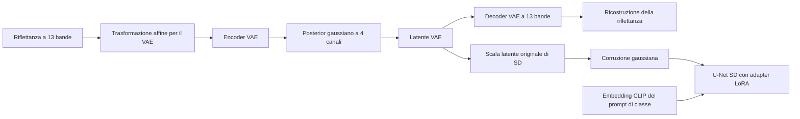
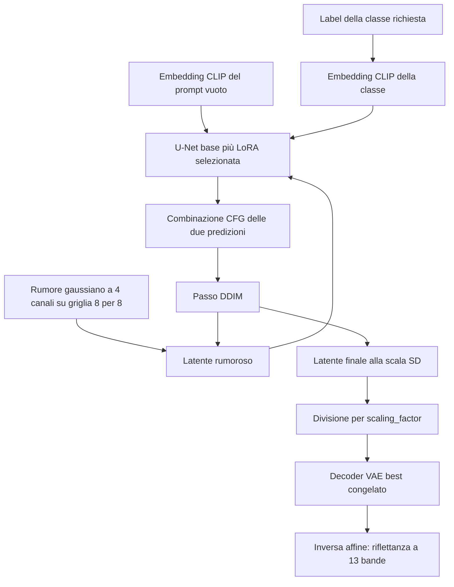

# Stable Diffusion multispettrale su EuroSAT — documentazione tecnica

Questa guida descrive [stable-diffusion-msi.ipynb](stable-diffusion-msi.ipynb).
Collega obiettivi scientifici, rappresentazioni dei dati e funzioni del notebook,
per permettere di leggerlo e modificarlo con un sistema di riferimento chiaro.
Le motivazioni e le alternative sono interpretazioni dell'architettura
implementata, non risultati sperimentali di confronti fra varianti.

I riferimenti alle **celle** contano tutte le celle, incluse quelle Markdown,
partendo da **1**. Non indicano il contatore di esecuzione `In [n]`, che cambia
con la sessione. Il nome di funzione rimane il riferimento più utile quando
si aggiungono o si spostano celle. Il config effettivo è il dizionario `config`
nella cella 4, non un file JSON esterno.

## Indice

1. [Scope: problema, architettura, dati e criticità](#1-scope-problema-architettura-dati-e-criticità)
2. [Blocchi necessari e motivazioni](#2-blocchi-necessari-e-motivazioni)
3. [Flusso dei dati: concetti e implementazione](#3-flusso-dei-dati-concetti-e-implementazione)
4. [Preview, risultati e analisi](#4-preview-risultati-e-analisi)
5. [Modificare il notebook e collegarlo alle specifiche](#5-modificare-il-notebook-e-collegarlo-alle-specifiche)
6. [Riferimenti](#6-riferimenti)

## 1. Scope: problema, architettura, dati e criticità

### 1.1 Problema affrontato

Il progetto genera immagini satellitari a tredici bande. La qualità non si
esaurisce nel realismo RGB: contano le relazioni fra bande, le firme spettrali
medie delle classi e la variabilità dei campioni. Il notebook studia il
trasferimento di **Stable Diffusion 1.5**, originariamente costruita per immagini
RGB, a **EuroSAT multispettrale**.

La strategia separa due problemi:

1. apprendere una rappresentazione compressa che permetta di ricostruire tutte
   le bande;
2. adattare il generatore preaddestrato alla distribuzione di quella
   rappresentazione e alle classi EuroSAT.

Il primo problema viene affrontato con il fine-tuning del VAE; il secondo con
adapter LoRA nella U-Net. Sono due ottimizzazioni successive, con loss,
validation e checkpoint distinti. Il VAE selezionato nella prima fase viene
congelato durante la seconda.

### 1.2 Architettura complessiva



Nel primo stadio si aggiornano **tutti i parametri del VAE**. Il corpo interno
parte dai pesi preaddestrati; le convoluzioni esterne vengono sostituite per
accettare e produrre tredici bande.

Nel secondo stadio il VAE è congelato e i pesi di base della U-Net sono
congelati. Si aggiornano soltanto gli adapter LoRA aggiunti all'attenzione e
alle convoluzioni di ingresso/uscita della U-Net. CLIP fornisce embedding
testuali fissi: non viene addestrato.

La generazione finale parte dal rumore nel latente, lo denoisa con la U-Net
condizionata e usa il decoder VAE per ottenere le tredici bande. Non richiede
un'immagine reale in ingresso.

Questa separazione fra autoencoder e diffusione segue l'impostazione dei
latent diffusion models: il denoising avviene in una rappresentazione compressa
anziché direttamente nello spazio dei pixel.
[Rombach et al., High-Resolution Image Synthesis with Latent Diffusion Models](https://arxiv.org/abs/2112.10752)

### 1.3 Dati e forme dei tensori

EuroSAT MS viene letto da TIFF `64×64×13`, organizzati in directory di classe.
Il notebook implementa un proprio `EuroSATMSDataset`: è autonomo e non importa
il `dataset.py` della root, pur mantenendone l'ordinamento di classi e file.
Non usa il dataset EuroSAT RGB come input aggiuntivo.

Notazione: `B` è il numero di immagini del batch, `N` il numero di classi,
`C` le bande, `H,W` le dimensioni dell'immagine; `L,D` descrivono la sequenza
di embedding testuali. Nella configurazione attuale `N=10` e `C=13`.

| Oggetto | Simbolo usato nella guida | Forma attuale | Significato |
| --- | --- | --- | --- |
| TIFF letto da disco | `d` | `[64,64,13]` | Valori nella scala del dataset |
| Riflettanza del batch | `r` | `[B,13,64,64]` | Output dei loader |
| Label intere | `labels` | `[B]` | Una classe per immagine, valori da `0` a `N-1` |
| Input normalizzato VAE | `x` | `[B,13,64,64]` | `2*r-1` |
| Media e log-varianza del posterior | `mu`, `logvar` | Ciascuna `[B,4,8,8]` | Parametri della distribuzione condizionata all'immagine |
| Latente interno al VAE | `z_vae` | `[B,4,8,8]` | Campione del posterior o sua moda |
| Latente della diffusione | `z_sd` | `[B,4,8,8]` | `scaling_factor * z_vae` |
| Rumore, latente rumoroso e rumore predetto | `noise`, `noisy`, `predicted` | Ciascuno `[B,4,8,8]` | Quantità nello spazio della diffusione |
| Embedding di tutte le classi | `sd_conditioning["classes"]` | `[N,L,D]` | Una sequenza CLIP per prompt |
| Embedding nullo | `sd_conditioning["null"]` | `[1,L,D]` | Sequenza CLIP del prompt vuoto |
| Contesto di un batch | `context` | `[B,L,D]` | Sequenze selezionate dalle label |

La riduzione spaziale del VAE è di un fattore otto per asse. Si passa quindi
da `13*64*64` valori a `4*8*8` coordinate campionate: il rapporto fra questi
conteggi è 208. Non è una misura dell'informazione conservata, ma mostra quanto
è stretto il collo di bottiglia. Le tredici bande non corrispondono ai quattro
canali latenti uno a uno.

L'ordine spettrale resta quello dei TIFF:

```text
B1 B2 B3 B4 B5 B6 B7 B8 B9 B10 B11 B12 B8A
```

`B8A` è in ultima posizione nel tensore. Per i grafici si ordinano le lunghezze
d'onda, senza riordinare l'input del modello. Modificare soltanto `band_names`
non modifica l'ordine fisico dei canali letti.

### 1.4 Criticità specifiche dell'architettura

**Questo latente è appreso e non ha vincoli fisici espliciti.** Non ci sono
ILR, abundance, simplesso o basi di materiali. I quattro canali sono feature
libere del VAE. La KL regolarizza il posterior, ma non impone positività della
riflettanza, correttezza di indici spettrali o identità di materiali. L'output
può contenere valori negativi o sopra uno; il notebook li conserva per
analizzarli.

**Compatibilità di forma e compatibilità statistica sono diverse.** Conservare
quattro canali rende possibile collegare il VAE alla U-Net originale. Non
garantisce che il significato delle feature, le loro scale, le correlazioni
o il contenuto spaziale restino quelli attesi dalla U-Net preaddestrata.
Il fine-tuning dell'intero VAE può cambiare tale rappresentazione. Gli adapter,
compresi quelli sulle convoluzioni esterne, tentano di adattare il denoiser;
il successo va misurato.

**La scala latente originale viene conservata, non ricalibrata.** Il valore
`sd_vae.config.scaling_factor` proviene dal modello di partenza. Dopo il
fine-tuning multispettrale il notebook non stima nuovamente la varianza del
latente. Il prodotto con quel fattore non assicura quindi una varianza
effettivamente unitaria sul nuovo dataset. La sezione 2.3 spiega perché conta
per il rapporto segnale/rumore della diffusione.

**La compressione può perdere dettagli e relazioni spettrali.** Il decoder
può generare soltanto ciò che il VAE riesce a rappresentare. Un ottimo denoiser
non recupera automaticamente strutture o informazioni scartate dalla prima
fase. Per questo l'evaluation distingue ricostruzione VAE e generazione SD.

**Il trasferimento parte da un dominio diverso.** La rete eredita prior RGB
e una scala spaziale di pretraining diversa dalle piccole patch EuroSAT. La
U-Net riceve qui una griglia latente `8×8`: poterla elaborare non implica che
i dettagli satellitari siano già modellati adeguatamente. Inoltre LoRA limita
la famiglia degli aggiornamenti rispetto al fine-tuning completo.

## 2. Blocchi necessari e motivazioni

### 2.1 Mappa del notebook

Tutti i simboli della tabella sono definiti nel
[notebook sorgente](stable-diffusion-msi.ipynb). Le celle di avvio sono distinte
da quelle che definiscono le funzioni.

| Celle | Simboli o operazione | Responsabilità |
| --- | --- | --- |
| 3–4 | Installazione, import, `config` | Ambiente e configurazione centralizzata |
| 6 | `read_reflectance`, `normalize_for_vae`, `denormalize_from_vae`, `reflectance_to_rgb` | Unità fisiche, input VAE e rendering |
| 8–11 | `find_dataset`, `EuroSATMSDataset`, controlli iniziali | Inventario deterministico e verifica degli esempi |
| 13 | `split_indices`, `load_or_create_split` | Split stratificato e manifest portabile |
| 15–17 | `BalancedBatchSampler`, loader e controllo batch | Bilanciamento del training e partizioni di validation/test |
| 19 | `adapt_vae`, `vae_loss` | Adattamento a tredici bande e obiettivo VAE |
| 21–22 | `prepare_run`, `resume_settings`, RNG, `initialize_vae` e probe | Identità della run e costruzione/ripresa del VAE |
| 24 | `save_image_comparison`, `save_vae_preview` | Monitor delle ricostruzioni |
| 26–27 | `run_epoch`, `append_log`, `save_checkpoint`, `train_vae` e avvio | Runtime comune ai due stadi e training VAE |
| 29 | Ricaricamento `best` ed export `vae_best/` | Fissare la rappresentazione selezionata |
| 31–32 | Stato LoRA/EMA, `create_class_embeddings`, `initialize_sd`, `encode_sd_images`, `sd_loss` e probe | Costruzione del secondo stadio |
| 34 | `validation_reference`, `sample_sd_batch`, `sample_sd`, `save_sd_preview` | Generazione del tensore e monitor generativo |
| 36–37 | `train_sd` e avvio | Training degli adapter con validation EMA |
| 39 | Ricaricamento adapter `best` ed export `lora_best/` | Versione EMA selezionata per inferenza |
| 41–42 | `load_sd_best`, `generate_final_samples`, scrittura dei campioni e avvio | Sampling finale e manifest |
| 44 | `image_statistics`, `compare_spectra`, `paired_reconstruction_metrics`, altre metriche | Distinguere confronti appaiati e distribuzionali |
| 45–47 | `save_evaluation_plots`, `evaluate_results`, `save_evaluation_report` e avvio | Valutazione finale sul test ed esportazione delle analisi |

Il notebook contiene dipendenze di sessione: molte funzioni leggono variabili
globali come `config`, `dataset`, `splits`, `train_loader`, `sd_vae`,
`sd_scheduler` e `sd_conditioning`. Non sono API autonome ottenibili copiando
una sola definizione. Occorre eseguire le celle che costruiscono i loro input
e rispettare l'ordine dei due stadi.

### 2.2 Dataset, split e batch bilanciati

`read_reflectance` legge il TIFF in `float32`, converte da `[H,W,C]` a
`[C,H,W]` e divide per `data.normalization_max`. Non applica resize, clipping,
augmentation o normalizzazioni statistiche.

`find_dataset` cerca una sola directory chiamata `EuroSAT_MS` sotto gli input
Kaggle. Se ce ne sono più di una, richiede di impostare esplicitamente la root:
scegliere un dataset arbitrario renderebbe ambigua la provenienza della run.

`EuroSATMSDataset` ordina directory e TIFF. La stabilità di questo ordinamento
è necessaria perché split e associazioni label–prompt si riferiscono a quegli
indici. Il caricamento resta su richiesta; l'intero dataset non è mantenuto
in memoria dai loader.

`split_indices` mescola ogni classe con un generatore CPU deterministico e
crea training, validation e test con quote 90/5/5. Training e validation usano
dimensioni arrotondate per difetto, il test riceve il resto. Per il dataset
completo di 27.000 immagini, i totali attesi sono 24.300/1.350/1.350.

`load_or_create_split` conserva `split_manifest.json`, con nomi delle classi,
percorsi relativi dei file, seed, quote e indici. Verifica inventario, copertura,
assenza di sovrapposizioni e conteggi per classe. Il manifest permette di
spostare il dataset fra sessioni senza cambiare lo split. **Non contiene hash
dei TIFF:** cambiare i contenuti mantenendo gli stessi nomi non viene rilevato
dal solo controllo dell'inventario.

`BalancedBatchSampler` emette un numero uguale di immagini per classe in ogni
batch. Questo rende il contributo atteso delle classi più uniforme in entrambi
gli stadi. Senza bilanciamento, le classi più numerose contribuirebbero più
spesso agli aggiornamenti. Non è il solo modo di bilanciare: si potrebbero
pesare le loss, ma cambierebbero frequenze di lettura e composizione dei batch.

Le classi piccole sono ripetute fino a coprire quella più grande. Un'epoca
non corrisponde quindi a una sola visita per immagine. Il batch size deve
essere un multiplo positivo del numero di classi. Il training chiama
`set_epoch(epoch - 1)`, così il sampler usa `seed + epoch - 1` e ricostruisce
l'ordine anche dopo un resume. Validation e test non sono sovracampionati.

### 2.3 Le trasformazioni da distinguere: dove e perché

| Trasformazione | Dove | Formula | Funzione |
| --- | --- | --- | --- |
| Scala radiometrica | `read_reflectance` | `r = d / normalization_max` | Portare il dato nelle unità di riflettanza usate dal progetto |
| Input del VAE | `normalize_for_vae` | `x = 2*r - 1` | Usare la convenzione affine dell'input VAE preaddestrato |
| Scala del latente SD | `encode_sd_images` | `z_sd = s*z_vae` | Collegare i latenti del VAE alla scala usata dal denoiser |
| Inversa latente | `sample_sd_batch` | `z_vae = z_sd/s` | Restituire al decoder la scala del suo latente interno |
| Output fisico | `denormalize_from_vae` | `r_hat = (x_hat+1)/2` | Interpretare l'output del decoder come riflettanza |
| Visualizzazione RGB | `reflectance_to_rgb` | `clip(r[B4,B3,B2]/display_max, 0, 1)` | Rendere confrontabili i PNG con un punto di bianco comune |

**Scala radiometrica.** Senza la divisione per la scala, valori TIFF dell'ordine
delle migliaia verrebbero interpretati come riflettanze. Applicare poi `2*r-1`
non correggerebbe l'errore di unità: produrrebbe input di scala completamente
diversa da quella prevista. Dividere una seconda volta i TIFF sintetici
sarebbe l'errore inverso, perché contengono già riflettanza.

**Trasformazione del VAE.** `[0,1]` viene mappato in `[-1,1]`, ma non viene
imposto che tutti i dati appartengano a questi intervalli. Per esempio:

```text
riflettanza r       -0.05     0      0.30     1      1.20
input VAE 2*r-1     -1.10    -1     -0.40     1      1.40
```

L'inversa recupera anche i valori esterni. Non è una normalizzazione min–max
per immagine e non è uno z-score per banda. Mantiene differenze assolute di
riflettanza e confrontabilità dei campioni. Un min–max indipendente per ogni
banda e immagine eliminerebbe informazione di ampiezza e richiederebbe
conservare statistiche per invertire il risultato; in generazione quelle
statistiche non sarebbero disponibili automaticamente.

La scelta affine mantiene la convenzione di input del VAE senza pretendere
che il multispettrale abbia la stessa distribuzione del suo pretraining.
Una standardizzazione per banda sarebbe possibile, ma richiederebbe un altro
contratto di inversione e cambierebbe il peso degli errori spettrali nella loss.

**Scala latente.** `s` è `sd_vae.config.scaling_factor`: un fattore scalare
distinto sia dal downsampling spaziale sia dalla scala radiometrica. Il codice
lo moltiplica prima di aggiungere rumore e lo divide prima di decodificare.
Questa è la convenzione dell'API AutoencoderKL per l'uso nella diffusione.
[Documentazione AutoencoderKL](https://huggingface.co/docs/diffusers/api/models/autoencoderkl)

Perché è necessario? La schedule definisce quanto rumore di varianza unitaria
aggiungere a ogni timestep. Una diversa ampiezza del segnale latente cambia
il rapporto segnale/rumore effettivo, anche a parità di schedule. Omettere `s`
nel training modificherebbe quel problema; omettere `1/s` in generazione
invierebbe al decoder feature con la scala sbagliata.

Il notebook conserva il fattore originale e non ricalibra il nuovo latente
EuroSAT. Una ricalibrazione sarebbe una variante da definire **prima** di
addestrare SD, stimandola solo sul training. Dovrebbe usare una statistica
coerente con i latenti campionati che SD vede in training: la varianza delle
sole medie del posterior non include la sua varianza condizionata.
Cambiare `s` soltanto al momento della generazione romperebbe la coerenza
con il denoiser già addestrato.

**Normalizzazioni interne alle reti.** I moduli preaddestrati conservano le
proprie normalizzazioni delle feature, fra cui GroupNorm nei blocchi
convoluzionali. Non sono trasformazioni della riflettanza e non vengono
invertite con `denormalize_from_vae`. Il notebook non stima medie/std di banda
né statistiche latenti per classe. L'adattamento delle feature avviene attraverso
i pesi addestrabili, non attraverso una nuova standardizzazione del dataset.

Queste normalizzazioni interne aiutano a controllare le scale delle attivazioni.
GroupNorm opera per campione e gruppo di canali, senza richiedere statistiche
di un batch grande. Rimuoverla o sostituirla con BatchNorm non sarebbe una
semplice variazione del preprocessing: cambierebbe il modello preaddestrato
e il suo comportamento. Nella fase VAE anche i suoi parametri addestrabili
vengono aggiornati; nella base U-Net rimangono congelati insieme agli altri
pesi non LoRA.

**Rendering.** Il punto di bianco RGB è comune a reali, ricostruzioni e campioni.
Il clipping viene usato solo qui. Applicarlo prima della loss, delle metriche
o del TIFF eliminerebbe parte degli errori e nasconderebbe uscite fuori range.

### 2.4 Adattamento e obiettivo del VAE

`adapt_vae` sostituisce `encoder.conv_in` e `decoder.conv_out` con nuove
convoluzioni `nn.Conv2d`. Tutte le tredici bande usano la stessa regola di
inizializzazione casuale standard; non si copiano i pesi RGB su tre canali
privilegiati. Le altre componenti restano inizialmente quelle del VAE SD 1.5.

`register_to_config` aggiorna anche i metadati di ingresso, uscita e dimensione
immagine. Non basta cambiare i tensori dei pesi: il resume ricostruisce il VAE
da `model_config` e deve ottenere un'architettura a tredici bande.

Si potrebbero preservare le connessioni RGB originali o addestrare soltanto
gli strati esterni. La prima alternativa introdurrebbe un'inizializzazione
diversa fra bande; la seconda limiterebbe la capacità di adattare il corpo del
VAE. La scelta corrente aggiorna tutto il modello, aumentando la capacità di
ricostruzione e anche la possibilità di allontanarsi dal vecchio latente.

`vae.encode(x).latent_dist` produce una gaussiana diagonale condizionata
all'immagine. Media e log-varianza hanno quattro canali ciascuna:

```text
q(z_vae | x) = N(mu(x), diag(exp(logvar(x))))
z_vae = mu + exp(logvar/2) * eta,    eta ~ N(0,I)
```

In training `posterior.sample()` usa un campione differenziabile della
distribuzione. In validation e ricostruzione si usa `posterior.mode()`, che
per questa gaussiana coincide con `mu`. Il decoder della moda non è, in
generale, la media delle immagini decodificate da tutti i campioni.

La loss implementata è:

```text
L1 = mean(abs(x_hat - x))
KL = mean(0.5 * (mu² + exp(logvar) - 1 - logvar))
loss = L1 + kl_weight * KL
```

La media della KL include batch, canali e posizioni latenti: è **KL media per
coordinata**, non la somma per immagine. Sostituirla con una KL sommata farebbe
cambiare il peso effettivo della regolarizzazione e richiederebbe rivalutare
`kl_weight`.

La L1 spinge a ricostruire i dati. La KL spinge il posterior verso una
gaussiana standard e limita rappresentazioni troppo libere; non è una loss
spettrale né assicura che la distribuzione aggregata del latente sia identica
a quella del VAE originario. Senza KL si avrebbe una diversa pressione sul
posterior, potenzialmente vantaggiosa per la sola ricostruzione ma meno
controllata come spazio per la diffusione. Una KL eccessiva può invece
penalizzare la capacità di conservare informazione dell'immagine.

La trasformazione affine permette di interpretare direttamente le metriche:

```text
mae_reflectance = L1 / 2
mse_reflectance = MSE(x_hat, x) / 4
rmse_reflectance = sqrt(mse_reflectance)
```

Non si applicano pesi diversi alle bande. Non sono presenti loss percettive,
avversarie, SAM o RMC nell'ottimizzazione. Il nome `AutoencoderKL` identifica
la famiglia del modello; non introduce automaticamente queste altre loss.

`vae_loss` restituisce un dizionario con `loss`, `l1_loss`, `kl_loss`,
`kl_weighted`, `mae_reflectance` e `mse_reflectance`. Solo `loss` guida il
backward e la scelta del best. Le metriche esclusivamente di monitoraggio
sono scollegate dal grafo.

Durante questa fase il decoder riceve `z_vae` **senza** moltiplicazione per
`scaling_factor`: quel fattore è il ponte con la diffusione, non un passaggio
interno obbligatorio della ricostruzione VAE.

### 2.5 Condizionamento tramite CLIP

`create_class_embeddings` ordina i prompt seguendo `dataset.classes`, li
tokenizza insieme al prompt vuoto e usa `CLIPTextModel.last_hidden_state`.
Si conservano sequenze di embedding, non un'unica categoria one-hot e non
un solo vettore di testo aggregato.

```text
label intera y → nome dataset.classes[y] → prompt configurato
              → tokenizer CLIP → encoder CLIP → sequenza [L,D]
```

CLIP viene eseguito una volta per una nuova run, in `eval` e senza gradienti;
gli embedding sono poi salvati nei checkpoint SD. Encoder testuale e tokenizer
vengono rimossi dalla memoria. In resume si riusano gli embedding salvati.

La U-Net riceve `encoder_hidden_states=context`. L'attenzione incrociata
permette alle feature dell'immagine rumorosa di usare quel contesto testuale.
La label non seleziona un encoder VAE diverso e non entra come `class_labels`
in una U-Net a embedding numerico di classe.

Un embedding di classe appreso da zero sarebbe un'alternativa più diretta,
ma richiederebbe adattare il contratto di condizionamento. I prompt CLIP
mantengono quello del modello preaddestrato, al costo di ereditare la sua
rappresentazione semantica. Il training usa soltanto dieci prompt fissi: non
verifica automaticamente la qualità per descrizioni testuali arbitrarie.

Per CFG, nel training alcuni embedding sono sostituiti dall'embedding del
prompt vuoto. Non si inserisce un'undicesima label numerica. Senza questo
dropout, la predizione senza condizione usata dalla guidance non riceverebbe
lo stesso adattamento al nuovo dominio.

### 2.6 LoRA: quali parametri cambiano e perché

La U-Net è `UNet2DConditionModel`: riceve il latente rumoroso, il timestep e
la sequenza di contesto. I blocchi di discesa elaborano feature a risoluzioni
progressivamente inferiori; quelli di risalita recuperano la risoluzione di
uscita usando anche le skip connection del ramo di discesa. Le connessioni
mantengono accessibili le feature spaziali mentre i livelli profondi trattano
un contesto più ampio. Si predicono quattro canali di rumore, non direttamente
le tredici bande.

Il timestep ha un ruolo diverso dal testo: indica il livello di corruzione
e viene incorporato nella rete tramite embedding temporali. Senza questa
informazione la stessa rete dovrebbe distinguere implicitamente problemi di
denoising con intensità diverse. L'attenzione sulle feature mette in relazione
posizioni spaziali; la cross-attention aggiunge il collegamento al contesto
CLIP. La struttura interna viene caricata dal modello preaddestrato, non
ridefinita manualmente nel notebook.

`initialize_sd` carica la U-Net della revisione fissata nel config, congela
i parametri esistenti e aggiunge `LoraConfig`. Per una proiezione lineare, il
principio dell'adapter può essere scritto come:

```text
W_effettivo = W_base + (alpha/rank) * B_lora * A_lora
```

Il rango limita la capacità dell'aggiornamento. Nel notebook `lora_alpha`
coincide con `lora_rank`. La configurazione include proiezioni di attenzione
`to_q`, `to_k`, `to_v`, `to_out.0` e convoluzioni `conv_in`, `conv_out`.
L'implementazione degli adapter, comprese le convoluzioni, è delegata a PEFT.
[Documentazione LoRA di PEFT](https://huggingface.co/docs/peft/developer_guides/lora)

Gli adapter di attenzione adattano l'elaborazione delle feature e del contesto.
Quelli sulle convoluzioni esterne permettono di correggere anche l'ingresso
e l'uscita rispetto al nuovo latente. Ciò non significa addestrare integralmente
quelle convoluzioni: i loro pesi di base restano congelati.

Senza alcun adattamento si userebbe un denoiser addestrato su un altro spazio
latente. Limitarsi alla cross-attention lascerebbe meno possibilità di adattare
il trattamento delle feature in ingresso e uscita. Il fine-tuning completo
avrebbe più capacità, ma anche più stato di training e un diverso compromesso
di memoria e rischio di sovradattamento. LoRA è la scelta sperimentale corrente,
non una garanzia che il cambiamento di latente sia interamente compensato.

`trainable_state` salva solo i parametri con `requires_grad=True`;
`load_trainable_state` controlla l'insieme dei nomi atteso e carica con
`strict=False` perché i pesi di base, deliberatamente assenti, esistono già
nel modello ricostruito. Un export `lora_best/` non è un generatore completo:
servono anche base SD corretta, VAE adattato e configurazione di inferenza.

### 2.7 Scheduler, obiettivo SD e precisione

`initialize_sd` carica il `DDPMScheduler` della stessa origine preaddestrata,
oppure lo ricostruisce dalla configurazione salvata per il resume. La loss
richiede `prediction_type == "epsilon"` e il codice lo controlla.

`sd_loss` usa:

```text
z_0 = scaling_factor * sample(q(z_vae | x))
epsilon ~ N(0,I),   t casuale per ogni immagine
z_t = sqrt(alpha_bar_t)*z_0 + sqrt(1-alpha_bar_t)*epsilon
loss = mean((U-Net(z_t, t, context) - epsilon)²)
```

Ci sono **due sorgenti di rumore distinte**: `eta` nel campionamento del
posterior VAE e `epsilon` aggiunto dallo scheduler. Il target della U-Net è
`epsilon`, non il rumore del posterior. Cambiare la schedule o usare un altro
target richiede mantenere coerenti training, validation e inferenza.

Lo scheduler del rumore non è uno scheduler del learning rate. Nei due
training il learning rate di AdamW resta costante; non ci sono warmup,
annealing o gradient accumulation. Ogni batch di training tenta un aggiornamento.

Il VAE è inizializzato con parametri `float32`. Lo stadio VAE usa per default
precisione completa; può abilitare fp16 via config. Il calcolo esplicito della
KL usa `float32`, per limitare overflow dell'esponenziale sotto autocast.

Nello stadio SD il VAE congelato viene eseguito in `float32`, disabilitando
l'autocast all'interno di `encode_sd_images`. La U-Net può usare fp16 nelle
operazioni sotto autocast, e la MSE è calcolata in `float32`. Questo non
equivale a convertire l'intero modello con `.half()`. La decodifica del sampling
è fuori dal contesto fp16 della U-Net.

`GradScaler` gestisce la scala dei gradienti; il clipping avviene dopo
`unscale_`. Il gradient checkpointing ricalcola attivazioni nel backward per
ridurre la memoria: non è il salvataggio dei checkpoint `.pt` e non sostituisce
il meccanismo di resume.

### 2.8 Runtime delle loss e EMA

`run_epoch` è condivisa dai due stadi all'interno del notebook. Riceve una
funzione con firma operativa:

```python
metrics = loss_function(model, reflectance, labels, training)
```

La funzione deve restituire scalari, fra cui `loss`. Il runtime verifica valori
finiti, esegue il backward soltanto su `loss`, accumula le medie di **tutte** le
chiavi pesandole per il numero di immagini e le mostra prima di throughput e
VRAM. Una nuova metrica non richiede un ramo specifico nel runtime.

`train_vae` fornisce il wrapper locale `batch_loss`, che chiama `vae_loss` e
ignora le label. `train_sd` fornisce direttamente `sd_loss`. Lo stato
`training` controlla campionamento del posterior e dropout del contesto,
non soltanto l'abilitazione dei gradienti.

Nello stadio SD `update_ema` aggiorna solo gli adapter:

```text
adapter_ema ← ema_decay * adapter_ema + (1-ema_decay) * adapter_training
```

La EMA usa decay fisso e parte dai parametri iniziali degli adapter; non c'è
warmup EMA. È uno smussamento dei pesi, non una normalizzazione dei dati.
`use_ema` salva i parametri correnti, carica EMA e li ripristina nel `finally`.
Validation, preview e selezione del best SD usano questa versione. I pesi di
training devono essere ripristinati per restare coerenti con l'optimizer.

## 3. Flusso dei dati: concetti e implementazione

Questa sezione segue i tensori e i gradienti. Non include scrittura di immagini,
creazione di report o produzione dei grafici, descritti nella sezione 4.
Gli estratti omettono parte della gestione device/log per rendere visibile
la corrispondenza con il concetto.

### 3.1 Preparazione comune

```text
CONCETTO                               CODICE
Inventario delle scene                  EuroSATMSDataset(data_root, scale)
   ↓                                      ↓
Separazione dei dati                    load_or_create_split(dataset, config)
   ↓                                      ↓
Visite bilanciate al training            BalancedBatchSampler(...)
   ↓                                      ↓
Batch di riflettanze e classi             train_loader → reflectance, labels
```

| Passo | Prima → dopo | Perché quell'ordine |
| --- | --- | --- |
| Lettura | TIFF `[H,W,C]` → riflettanza `[C,H,W]` | I loader devono fornire unità fisiche coerenti a entrambi gli stadi |
| Split | Inventario ordinato → indici training/validation/test | L'inventario determina il significato degli indici salvati |
| Batching | Indici training → batch bilanciato | Il bilanciamento non deve introdurre campioni di validation o test |
| Normalizzazione VAE | `r` → `x=2*r-1` nella loss o nell'encoding | Separarla dal dataset evita di trattare input VAE come riflettanza nelle analisi |

### 3.2 Stadio VAE: apprendere una ricostruzione multispettrale

Avvio: cella 27, `train_vae(vae, vae_run)`.

| Concetto | Implementazione | Forma / gradiente |
| --- | --- | --- |
| Immagine fisica | `reflectance` dal loader | `[B,13,64,64]` |
| Input del VAE | `inputs = normalize_for_vae(reflectance)` | Stessa forma |
| Posterior | `posterior = model.encode(inputs).latent_dist` | Media e logvar `[B,4,8,8]` |
| Rappresentazione stocastica | `latents = posterior.sample()` | `[B,4,8,8]`, gradiente verso encoder |
| Ricostruzione | `model.decode(latents).sample` | `[B,13,64,64]`, gradiente verso decoder ed encoder |
| Loss | `L1 + kl_weight*KL` | Gradiente verso tutto il VAE |

Il nucleo è direttamente in `vae_loss`:

```python
inputs = normalize_for_vae(reflectance)
posterior = model.encode(inputs).latent_dist
latents = posterior.sample() if sample else posterior.mode()
reconstruction = model.decode(latents).sample.float()
l1 = F.l1_loss(reconstruction, inputs.float())
```

Attenzione ai due usi del nome `sample`: `posterior.sample()` **estrae un
campione**; `.sample` nell'output del decoder è il **campo che contiene il
tensore decodificato**, non un nuovo sorteggio.

La label serve al bilanciamento e alle analisi, ma non condiziona il VAE.
Training e validation ricostruiscono gli stessi tipi di immagini, usando però
rispettivamente posterior campionato e deterministico. Di conseguenza le loss
dei due casi non hanno la stessa sorgente di variabilità.

La validation usa `run_epoch` con `optimizer=None`: mette il modello in `eval`
e disabilita i gradienti. Il best minimizza **L1 + KL pesata di validation**;
non è selezionato sul solo errore fisico, sulla RMC o sul test.

### 3.3 Ponte tra le fasi: fissare VAE e identità del latente

Nella cella 29 si ricarica il VAE `best`. `initialize_sd`, nella cella 31,
ricarica comunque il checkpoint VAE selezionato da `sd_training.vae_checkpoint`
oppure dal best della run precedente, verifica il manifest e congela il modello:

```python
vae.load_state_dict(vae_checkpoint["model"])
vae.requires_grad_(False).eval()
```

`sd_vae` è il VAE passato e poi restituito da `initialize_sd`, non un altro
modello addestrato a parte. Lo stadio SD usa quindi una rappresentazione fissa.
Cambiare contemporaneamente i pesi del VAE renderebbe mobili i target latenti
della U-Net e invaliderebbe l'associazione fra denoiser e decoder.

`source_vae` conserva percorso, epoca e SHA-256 del **file checkpoint**. Il
resume SD richiede lo stesso hash. È un controllo più stretto della sola
uguaglianza dei pesi: risalvare gli stessi pesi in un file diverso per metadati
o serializzazione può cambiare l'hash. Spostare il file lasciando invariati i
byte, invece, ne preserva l'identità per questo controllo.

### 3.4 Stadio SD: dal multispettrale alla MSE sul rumore

Avvio: cella 37, `train_sd(unet, sd_run)`.

```text
CONCETTO                               CODICE
Riflettanza reale                       images
   ↓                                      ↓
Rappresentazione VAE congelata           encode_sd_images(images, sample=True)
   ↓                                      ↓
Latente alla scala di SD                 posterior.sample() * scaling_factor
   ↓                                      ↓
Corruzione a timestep casuale            sd_scheduler.add_noise(latents, noise, timesteps)
   ↓                                      ↓
Contesto di classe, talvolta nullo       sd_conditioning["classes"][labels] e torch.where
   ↓                                      ↓
Rumore predetto                         model(noisy, timesteps, encoder_hidden_states=context).sample
   ↓                                      ↓
Aggiornamento degli adapter              MSE(predicted, noise) → backward → optimizer
```

`encode_sd_images` è decorata con `torch.no_grad()`. Non costruisce un grafo
attraverso il VAE. Si calcola comunque il posterior a ogni batch: non esiste
una cache dei latenti e il campionamento del posterior cambia durante il training.

Il corpo essenziale della loss è:

```python
latents = encode_sd_images(images, sample=training)
noise = torch.randn_like(latents)
timesteps = torch.randint(sd_scheduler.config.num_train_timesteps,
                          (len(images),), device=images.device)
context = sd_conditioning["classes"][labels]
noisy = sd_scheduler.add_noise(latents, noise, timesteps)
predicted = model(noisy, timesteps, encoder_hidden_states=context).sample
mse = F.mse_loss(predicted.float(), noise.float())
```

Il codice completo aggiunge il dropout del contesto soltanto in training.
Un timestep è estratto per immagine; il rumore ha invece un valore per ogni
coordinata latente. Lo stesso schema funziona per batch con classi diverse.

Nella loss SD il decoder **non viene eseguito**. Non c'è un errore sulle bande
o una componente fisica nell'obiettivo: si sta adattando una distribuzione
latente mediante denoising. VAE e base U-Net restano congelati; i gradienti
aggiornano soltanto LoRA. Il congelamento dei parametri della U-Net non equivale
a disabilitare l'intero forward con `no_grad`, che impedirebbe il training
degli adapter.

### 3.5 Validation SD ed EMA

La validation SD differisce dal training in tre aspetti:

1. `encode_sd_images(..., sample=False)` usa la moda del posterior;
2. non viene eliminato il contesto di classe;
3. si valutano gli adapter EMA, non quelli di training.

Rumori e timestep sono resi riproducibili con `validation_seed`, dentro
`torch.random.fork_rng`. Questo conserva la sequenza RNG globale del training
e permette confronti fra epoche con la stessa corruzione, a parità di ordine
e batching. Il generatore del loader validation è separato e viene salvato
nello stato di resume; il caricamento dati qui è deterministico.

Il criterio `best` è la **MSE sul rumore di validation con EMA**. Una loss di
training più alta o più bassa non è direttamente confrontabile come stima
dello stesso identico scenario, perché cambiano campionamento, dropout e pesi.
Una MSE sul rumore migliore non dimostra da sola una migliore fedeltà spettrale.

### 3.6 Generazione: dal rumore al tensore multispettrale

Il nucleo è `sample_sd_batch` nella cella 34. Qui si descrive la costruzione
del tensore; scelta e scrittura dei file sono nella sezione 4.



| Concetto | Implementazione | Perché serve |
| --- | --- | --- |
| Forma della rappresentazione | `factor = 2 ** (len(sd_vae.config.block_out_channels)-1)` e `size=image_size//factor` | Il denoiser deve produrre una griglia compatibile con il decoder |
| Stato iniziale | `torch.randn((n, latent_channels, size, size), generator=...)` | Definisce la casualità del campione |
| Ampiezza iniziale | `latents *= scheduler.init_noise_sigma` | Rispetta la convenzione dello scheduler |
| Schedule inversa | `DDIMScheduler.from_config(sd_scheduler.config)` | Mantiene il processo di rumore di riferimento del training |
| Contesti CFG | Concatenazione prima null, poi classe | Le due metà devono corrispondere alle due copie dello stesso latente |
| Input del modello | `scheduler.scale_model_input(...)` | Applica l'eventuale convenzione di scala richiesta dallo scheduler |
| Predizioni | Forward U-Net con batch `2B` | Produce stima senza condizione e stima condizionale |
| Denoising | Formula CFG e `scheduler.step(...).prev_sample` | Aggiorna il latente fino al dato pulito stimato |
| Decodifica fisica | `decode(latents/scaling_factor)` e `denormalize_from_vae` | Restituisce scala VAE e poi riflettanza |

La formula di guidance è:

```text
epsilon_guided = epsilon_null + guidance_scale * (epsilon_class - epsilon_null)
```

Con scala uno coincide con la predizione condizionale; con scala zero con
quella nulla. Una scala maggiore può favorire l'aderenza alla classe, ma può
anche ridurre la diversità o peggiorare il comportamento spettrale. È un
parametro di inferenza, non una penalità fisica della loss.

La chiamata DDIM specifica `eta=0.0`: fissato il rumore iniziale, non introduce
ulteriore rumore stocastico nei passi inversi. Ambiente, batching e aritmetica
restano parte delle condizioni di riproducibilità.
[API DDIMScheduler](https://huggingface.co/docs/diffusers/api/schedulers/ddim)

L'ultima trasformazione del percorso è esattamente:

```python
generated = denormalize_from_vae(
    sd_vae.decode(latents / float(sd_vae.config.scaling_factor)).sample
).float().cpu()
```

Non si usa l'encoder VAE per generare da rumore. Il decoder riceve feature
generate e può produrre valori esterni a `[0,1]`, senza sigmoid o clipping
aggiunti dal notebook. I controlli dei valori finiti rilevano NaN/Inf, non la
plausibilità fisica di uno spettro.

### 3.7 Checkpoint, run e dipendenze da preservare

Il sistema conserva due famiglie di run, VAE e SD. `prepare_run` sceglie per
il resume la run con indice numerico maggiore fra quelle dotate di `latest.pt`,
oppure il percorso esplicito `resume_checkpoint`. Con `resume=False` crea una
nuova run; specificare contemporaneamente un checkpoint di resume viene rifiutato.

`resume_settings` richiede coerenza di architettura, impostazioni di training,
batch, seed, dati e, per SD, adapter/prompt/CFG. Esclude dal confronto il numero
finale di epoche e i percorsi di trasferimento. È quindi possibile estendere
le epoche e spostare i dati mantenendo inventario e impostazioni compatibili.

| Artefatto | Contenuto e uso |
| --- | --- |
| VAE `latest.pt` | Stato completo: pesi, model config, optimizer, scaler, epoca, global step, best loss, metriche, config, split manifest e RNG |
| VAE `best.pt` | Stesso tipo di checkpoint completo, aggiornato sul miglior valore della loss di validation |
| `vae_best/` | Export Diffusers del VAE selezionato; utile per inferenza, non sostituisce lo stato di optimizer/RNG per resume |
| SD `latest.pt` | Adapter di training e EMA separati, optimizer, scaler, epoca/step, RNG, configurazione scheduler, embedding, config, split e identità VAE |
| SD `best.pt` | Adapter EMA, metriche e metadati per inferenza; non contiene optimizer/scaler/RNG per riprendere il training |
| `lora_best/` | Export dei soli adapter selezionati, da associare alla base SD e al VAE corretti |

I pesi congelati della U-Net non sono duplicati in ogni checkpoint SD:
vengono ricostruiti dal `model_id` e dalla revisione fissata. Lo stato dello
scheduler del rumore è conservato come configurazione; non esiste uno scheduler
del learning rate da ripristinare.

`get_random_state` salva RNG Python, NumPy, PyTorch CPU/CUDA e generatori dei
loader training e validation. L'ordine del sampler è ricostruito dall'epoca.
Il test loader non partecipa al training. `save_checkpoint` scrive prima un
file temporaneo e poi lo sostituisce al file destinazione.

Il resume riparte dall'ultima **epoca completa**, ripetendo l'eventuale epoca
interrotta. I record già scritti per un'epoca parziale possono restare nel JSONL:
non vanno contati come una seconda epoca completata. L'evento `resume` permette
di riconoscere la ripresa. `global_step` conta i batch di training tentati,
anche quando AMP salta un aggiornamento; il campo `optimizer_step` nei log
indica se l'aggiornamento è stato considerato valido.

Per continuare da un output Kaggle collegato come input, servono `latest.pt`
e il corrispondente `best.pt` nella stessa directory. `prepare_run` copia il
best nel percorso scrivibile della run. Per SD devono essere disponibili anche
il VAE di identico hash e la base preaddestrata della revisione richiesta.
Usare una sessione con directory di run non ambigue: i training rileggono un
`latest.pt` già presente nella directory locale della run.

## 4. Preview, risultati e analisi

Questi blocchi osservano o persistono i risultati. La loro logica è separata
dal significato delle loss e dal percorso dei tensori descritto sopra.

### 4.1 Monitor a fine epoca

`save_vae_preview` sceglie la prima immagine di validation di ciascuna classe
secondo lo split fissato. Ricostruisce con la moda del posterior, confronta
RGB e firme medie e restituisce MAE/RMSE, errore RMC e frazioni fuori range.
Queste metriche riguardano dieci esempi; la validation loss usa invece l'intera
validation.

`validation_reference` prepara per SD gli stessi esempi reali fissi e le RMC
medie **di tutta la validation**, una volta prima del ciclo delle epoche.
`save_sd_preview` genera un campione per classe con seed fisso e confronta le
sue medie spettrali con quei riferimenti. Registra errore RMC, frazioni fuori
range e variabilità spaziale. I pesi usati durante il training SD sono EMA.

I reali e i generati mostrati vicini non sono coppie corrispondenti. Per questi
campioni non si calcola una MSE pixel per pixel. Una preview con RMC vicina è
un monitor preliminare, non un criterio alternativo al best di validation.

`save_image_comparison` salva due figure, `<nome>_rgb.png` e `<nome>_rmc.png`,
nella directory delle preview della run. Il rendering RGB usa sempre
`reflectance_to_rgb` con lo stesso punto di bianco.

### 4.2 Sampling finale e provenienza

`generate_final_samples`, cella 41, non si affida ai pesi rimasti in memoria:
chiama `load_sd_best`, controlla che siano EMA e che l'identità VAE coincida,
poi carica gli adapter del best.

La funzione completa una classe prima di passare alla successiva. Per ogni
batch usa:

```text
seed_batch = sampling.seed + label * 1_000_000 + start
```

`start` è l'offset del batch nella classe. Cambiare il batch size cambia
raggruppamenti e seed dei batch successivi, quindi non va considerato un
dettaglio ininfluente per riprodurre lo stesso insieme di campioni.

`save_multispectral_sample` scrive un TIFF `float32`, in layout `[H,W,C]`,
con tutte le bande e metadati sull'ordine dei canali. Non riapplica la scala
intera e **non applica clipping**, neppure inferiore. Il PNG RGB è invece un
rendering a otto bit e usa clipping. Ricavare metriche fisiche dal PNG perderebbe
bande, precisione e informazione fuori range.

La directory segue il formato:

```text
outputs/results/stable_diffusion_msi/
  stable_diffusion_msi-sampling_i-run_j/
    split_manifest.json
    sampling.json
    samples/<classe>/MS/<nome>.tif
    samples/<classe>/RGB/<nome>.png
```

`sampling.json` conserva checkpoint e hash, VAE sorgente, config, scheduler,
precisione, versioni, seed e file di ogni batch/classe. Viene aggiornato dopo
ogni classe; `complete` diventa vero soltanto alla fine. Il manifest rileva un
sampling incompleto, ma non implementa un resume dei batch di sampling.

### 4.3 Evaluation sul test: due domande diverse

`evaluate_results` usa tutto il test fissato nel manifest e gli stessi campioni
del sampling precedente. Controlla completamento, split, identità VAE e almeno
due campioni generati per classe. Non genera un secondo insieme da confrontare.

**Ricostruzione:** `reconstruct_test_class` codifica ogni immagine reale del
test con la moda del posterior e la decodifica con il VAE congelato. Le coppie
reale/ricostruita hanno corrispondenza spaziale; è quindi sensato usare MAE,
RMSE e SAM per pixel con `paired_reconstruction_metrics`.

**Generazione:** immagini sintetiche e test sono insiemi indipendenti. Si
confrontano statistiche spettrali e distribuzioni aggregate con
`image_statistics` e `compare_spectra`. Non si sottrae un pixel sintetico a un
pixel reale scelto arbitrariamente.

Una buona ricostruzione e una cattiva generazione suggeriscono di esaminare
denoiser, condizionamento, scala latente e sampling; una ricostruzione già
debole indica un limite della rappresentazione. È una strategia diagnostica,
non una prova che ogni errore generativo possa essere attribuito a un solo blocco.

### 4.4 Cosa misurano esattamente le metriche

`image_statistics` calcola per immagine e banda media spaziale, std spaziale
di popolazione, frazioni negative e sopra uno, minimo e massimo. Per una
classe, la RMC è la media delle firme medie delle immagini. A parità di
dimensioni delle patch equivale alla media su tutti i pixel della classe.

| Metrica | Quantità confrontata | Interpretazione e limite |
| --- | --- | --- |
| `reconstruction_mae` | Pixel e bande di reale/ricostruita | Errore assoluto in riflettanza, solo per coppie corrispondenti |
| `reconstruction_rmse` | Stesse coppie | Più sensibile agli errori grandi |
| `reconstruction_sam_deg` | Angolo fra spettri dei pixel corrispondenti | Misura orientamento spettrale; da sola non rileva una riscalatura positiva dello spettro |
| `sam_valid_pixel_fraction` | Pixel con entrambe le norme spettrali sufficienti | Espone quanti pixel partecipano al SAM appaiato |
| `rmc_mae`, `rmc_rmse` | Due firme medie di classe, sulle tredici bande | Valutano bias della media, non la distribuzione completa |
| `rmc_sam_deg` | Angolo fra RMC | Distingue la forma relativa della firma media, non tutta la sua ampiezza |
| `mean_spectrum_w1` | Distribuzioni delle medie di ciascuna banda per immagine | Wasserstein-1 per banda, poi media sulle bande; non è distanza fra distribuzioni spettrali congiunte dei pixel |
| `between_image_std_ratio` | Media sulle bande della std campionaria delle medie per immagine, modello/reale | Riferimento uno; vicino a uno non esclude collasso su altre caratteristiche |
| `spatial_std_ratio` | Media delle std interne alle immagini, modello/reale | Riferimento uno; non misura disposizione spaziale né texture in modo completo |
| `negative_fraction`, `above_one_fraction` | Frazione dei valori fuori intervallo | Diagnostiche da confrontare anche con il reale, non correzioni da nascondere con clipping |

Il SAM appaiato esclude pixel se una delle norme non supera `1e-8` e registra
la frazione valida. L'angolo delle RMC viene restituito come `None` se il
prodotto delle norme è troppo piccolo. Rapporti con denominatore nullo sono
anch'essi `None`: non vanno sostituiti automaticamente con zero.

Le fasce nei grafici RMC sono **±1 deviazione standard campionaria fra le
medie delle immagini**, con `ddof=1`. Non rappresentano la dispersione di tutti
i pixel, un intervallo di confidenza o l'incertezza fra training indipendenti.

`macro_metrics` assegna lo stesso peso a ogni classe e media i valori definiti,
escludendo `None`. In particolare il RMSE macro è la media dei RMSE per classe:
non è il RMSE ottenuto concatenando tutti i pixel. Tutti i confronti fisici
usano riflettanze senza clipping.

### 4.5 File dell'evaluation e memoria

```text
stable_diffusion_msi-eval_i-run_j/
  split_manifest.json
  evaluation.json
  report.md
  metrics_per_class.csv
  spectral_curves.csv
  image_statistics.csv
  samples/<classe>/MS/*_eval.tif
  samples/<classe>/RGB/*_eval.png
  reconstructions/<classe>/MS/*_reconstructed_eval.tif
  reconstructions/<classe>/RGB/*_reconstructed_eval.png
  plots/rmc_all_classes.png
  plots/rmc_macro.png
  plots/metrics_comparison.png
  plots/rgb_comparison.png
```

I campioni valutati sono copie dei TIFF/PNG del sampling, con suffisso `_eval`.
Le ricostruzioni vengono invece calcolate dal test. L'evaluation conserva
metriche, protocollo e riferimenti ai file in JSON, CSV e report.

Il percorso è organizzato per classe, ma non è interamente streaming:
`reconstruct_test_class` carica su CPU le immagini reali della classe e conserva
le ricostruzioni; anche i generati della classe vengono impilati in memoria.
Il batch di evaluation limita il lavoro GPU di ricostruzione, non tutta la
memoria CPU. Aumentare molto patch, dataset o campioni richiede considerare
anche questo consumo.

## 5. Modificare il notebook e collegarlo alle specifiche

### 5.1 Punti di intervento

| Obiettivo della modifica | Celle/simboli da leggere | Contratti da preservare |
| --- | --- | --- |
| Cambiare dataset o ordine delle bande | 4, 6, 8, 13: config, lettura, dataset e manifest | Unità, mapping classi e canali, prompt, split e metadati devono concordare |
| Cambiare numero di bande | `adapt_vae`, `data.band_names`, metriche/export | Input/output VAE coerenti; nuovo VAE e nuova run SD associata |
| Cambiare dimensione delle patch | Config, `adapt_vae`, probe e `sample_sd_batch` | Dimensioni compatibili con riduzioni spaziali di VAE/U-Net; rivedere memoria e compressione |
| Cambiare normalizzazione VAE | `normalize_for_vae`, `denormalize_from_vae`, `vae_loss` e tutti i percorsi di ricostruzione | Inversa esatta e conversioni MAE/MSE aggiornate; nuova rappresentazione, non modifica solo del rendering |
| Ricalibrare la scala latente | `encode_sd_images`, `sample_sd_batch`, config/metadati VAE | Fit sul training, stessa scala in avanti e inversa in generazione; nuova run SD |
| Aggiungere una loss spettrale VAE | `vae_loss` | Calcolare nella scala fisica se necessario; conservare gradienti e restituire scalari con `loss` totale |
| Cambiare condizionamento | `sd_model.prompts`, `create_class_embeddings`, `sd_loss`, `sample_sd_batch` | Ordine classi, embedding nullo e dimensioni di cross-attention coerenti; nuova run se cambia il contratto |
| Cambiare capacità LoRA | `sd_model`, `initialize_sd`, stato/export adapter | Nuovi nomi o rango rendono incompatibili i vecchi adapter e l'optimizer |
| Fine-tuning completo della U-Net | `requires_grad_`, optimizer, `trainable_state`, EMA e checkpoint | I file non conterrebbero più soltanto LoRA; rivedere esplicitamente resume, memoria ed export |
| Aggiungere una loss fisica SD | `sd_loss`, scheduler e decoder VAE | Da rumore predetto ricavare una stima pulita, invertire la scala e decodificare mantenendo il grafo verso LoRA |
| Cambiare la schedule/il target | `initialize_sd`, `sd_loss`, `sample_sd_batch` | Il target `epsilon` e la configurazione dello scheduler devono essere coerenti |
| Aggiungere una metrica di monitoraggio | Dizionario loss o funzioni di preview | `run_epoch` logga automaticamente le chiavi; scollegare le metriche che non contribuiscono alla loss |
| Cambiare soltanto l'RGB | `rgb_display_max`, `reflectance_to_rgb` | Non alterare TIFF, loss o metriche fisiche |
| Aggiungere una metrica finale | `image_statistics`, `compare_spectra`, `paired_reconstruction_metrics`, report/plot | Distinguere coppie e insiemi indipendenti; non usare il test per scegliere best |

Se si introduce una loss fisica SD, non basta riusare `sample_sd_batch`: è
decorata con `no_grad` e pensata per inferenza. Servirebbe un percorso
differenziabile dal rumore predetto al latente pulito stimato e al decoder.
Il VAE può avere parametri congelati e permettere comunque gradienti rispetto
al suo **input**, purché il decoder non sia eseguito in `no_grad`.

Cambiare la loss cambia anche il significato del best, perché entrambi i
training selezionano sulla chiave `loss` di validation. Il runtime non decide
automaticamente se una nuova penalità vada valutata diversamente fra training
e validation: è responsabilità della funzione loss.

### 5.2 Specifiche generali e implementazione concreta

Il riferimento del repository è [AGENTS.md](../AGENTS.md). Il notebook è un
artefatto autonomo per Kaggle: alcune scelte organizzative sono quindi diverse
dagli entry point Python degli esperimenti locali.

| Specifica di alto livello | Collegamento concreto |
| --- | --- |
| Coerenza fisica multispettrale | Ricostruzione a tredici bande e valutazioni spettrali; nessun vincolo fisico esplicito nell'output o nella loss SD |
| Dataset EuroSAT | EuroSAT MS in input; RGB derivato dalle bande per visualizzazione |
| Config centralizzato e omogeneo | Dizionario `config` nella cella 4; snapshot `config.json` per run, non config separato accanto al notebook |
| Split riproducibile 90/5/5 | `split_indices` e `split_manifest.json` condiviso dai due stadi |
| Test fuori dal training e dalla scelta best | Test usato solo nell'evaluation finale; i due best sono scelti sulla validation |
| Batch bilanciati per classe | Un `BalancedBatchSampler` per il training di entrambi gli stadi |
| `latest` e `best` a fine epoca | Checkpoint separati per VAE e SD, con differente contenuto del best SD |
| EMA quando prevista | Solo stadio SD: validation, preview, best e sampling usano adapter EMA |
| Log incrementali e metriche modulari | `run_epoch` e `append_log`: tutte le chiavi scalari, valori correnti/medi, LR, gradienti, step, throughput e VRAM |
| Preview a ogni epoca in `outputs/previews/` | Monitor VAE e monitor SD nelle directory delle rispettive run |
| Sampling una classe alla volta, TIFF float32 in riflettanza e RGB abbinato | `generate_final_samples` e `save_multispectral_sample` |
| Risultati e figure sotto `outputs/`, log in `experiments/.../log/` | Percorsi configurati sotto `/kaggle/working`; gli input Kaggle restano separati |
| Runtime condiviso in `experiments/common/` | Non importato: `run_epoch` è condivisa solo fra gli stadi del notebook autonomo |
| Interfaccia generica `create_loss(config, scheduler, band_stats)` | Non adottata letteralmente: il notebook passa una funzione loss a `run_epoch` e usa lo stesso contratto a dizionario di scalari |

Gli iperparametri non sono una prova di correttezza teorica o fisica. I
controlli del notebook verificano forme, inventario, finitezza e coerenza di
stato; le metriche finali valutano aspetti specifici della qualità. Una
conclusione sperimentale richiede leggere insieme ricostruzioni, generazione
e limiti delle metriche, senza dedurla dal solo buon RGB.

### 5.3 Verifiche utili prima di un training costoso

1. **Unità e inversa:** `denormalize_from_vae(normalize_for_vae(r))` recupera
   `r`, anche per valori esterni a `[0,1]`; nessuna doppia divisione per 10.000.
2. **Forme:** posterior `[B,4,8,8]` e ricostruzione `[B,13,64,64]` per le
   patch correnti; label `[B]` e contesto `[B,L,D]`.
3. **KL e metriche:** media per coordinata e fattori `/2`, `/4` coerenti con
   la normalizzazione effettiva.
4. **Gradienti:** tutto il VAE addestrabile nel primo stadio; solo adapter
   addestrabili nel secondo; CLIP e VAE SD congelati.
5. **Scala latente:** moltiplicazione all'ingresso della diffusione e divisione
   prima del decoder, con lo stesso valore.
6. **Identità:** base/revisione, VAE/hash, ordine dei prompt e manifest devono
   appartenere allo stesso esperimento.
7. **EMA/resume:** il best SD deve contenere EMA; il latest deve conservare
   anche pesi di training, optimizer, scaler e RNG.
8. **Protocollo:** ricostruzioni appaiate e generati indipendenti devono seguire
   metriche diverse; il test rimane fuori da training e selezione del checkpoint.

## 6. Riferimenti

Il comportamento descritto è quello del
[notebook esaminato](stable-diffusion-msi.ipynb), che resta la fonte per config,
formule effettive e contenuti dei checkpoint.

- L'architettura di diffusione su rappresentazioni compresse è descritta da
  [Rombach et al., High-Resolution Image Synthesis with Latent Diffusion Models](https://arxiv.org/abs/2112.10752).
- Il contratto encode/decode e il fattore di scala sono documentati nell'
  [API AutoencoderKL](https://huggingface.co/docs/diffusers/api/models/autoencoderkl).
- La configurazione degli adapter è documentata nell'
  [API LoRA di PEFT](https://huggingface.co/docs/peft/developer_guides/lora).
- Il processo inverso e il parametro `eta` sono documentati nell'
  [API DDIMScheduler](https://huggingface.co/docs/diffusers/api/schedulers/ddim).

La cella 3 fissa le versioni delle dipendenze principali; il config fissa la
revisione dei pesi preaddestrati. La documentazione online può descrivere
versioni successive: per riprodurre una run contano ambiente e metadati
effettivamente utilizzati, oltre al codice del notebook.
